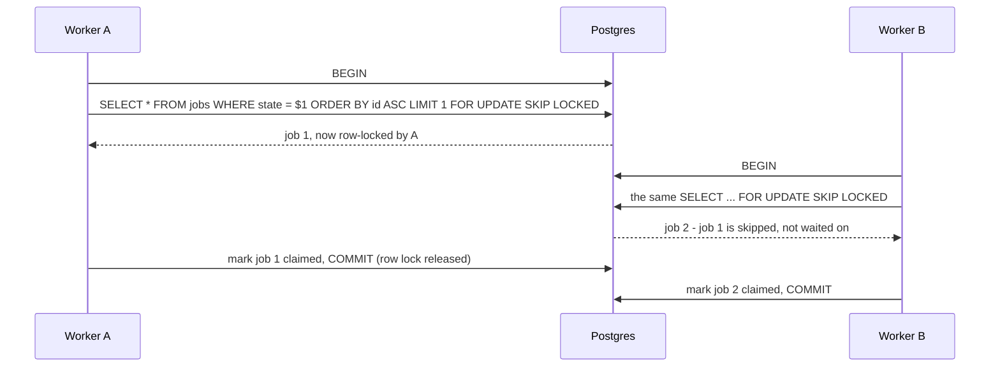
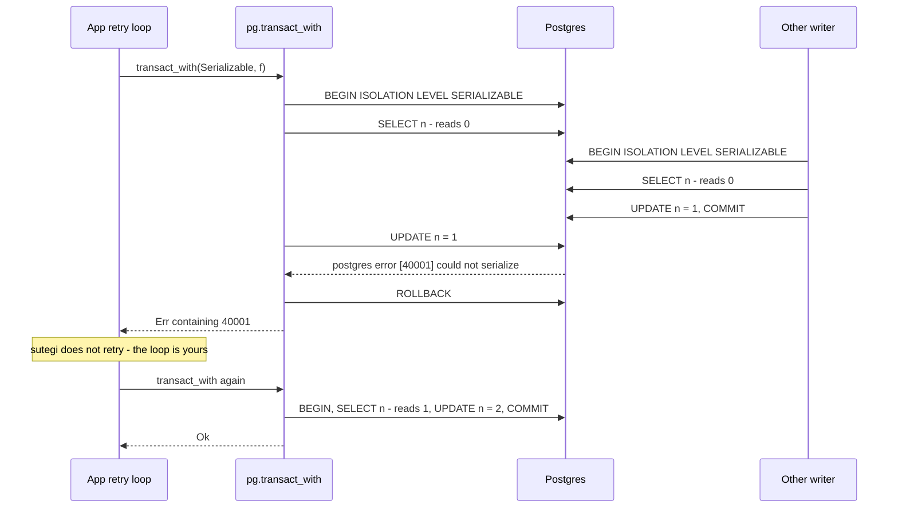

# Concurrency & throughput

Row locks, isolation levels, RETURNING on DML, and bulk insert — through the
same `Backend` seam, gated by `capabilities()` where the engines differ.

## Row locks

```rust
// The work-queue claim shape: take one unclaimed row, skip contended ones.
let claimed = tx.select(
    &QueryBuilder::table("jobs")
        .filter("state", "=", Value::Text("ready".into()))
        .order_by("id", false)
        .limit(1)
        .for_update()
        .skip_locked(),
)?;
```

- `for_update()` / `for_share()` — row locks inside a transaction.
- `.skip_locked()` — skip rows another transaction holds; `.nowait()` — error
  instead of blocking.
- **Dialects:** the builder stores the request; the executing backend emits
  it. Postgres emits `FOR UPDATE [SKIP LOCKED|NOWAIT]`. SQLite treats plain
  `for_update`/`for_share` as a no-op (a write transaction already holds the
  whole-database lock — strictly coarser), but `skip_locked`/`nowait`
  **error** with `unsupported`: altered contention semantics are the point,
  and SQLite can't express them.



## Isolation levels

```rust
db.transact_with(Isolation::Serializable, |tx| {
    let n = read_counter(tx)?;
    tx.execute("UPDATE counters SET n = ? WHERE id = 1", &[Value::Int(n + 1)])
})?; // a lost-update race surfaces as error 40001 — retry the transaction
```

Postgres: `BEGIN ISOLATION LEVEL READ COMMITTED | REPEATABLE READ |
SERIALIZABLE`. SQLite is always serializable; levels map to when the write
lock is taken (`Serializable` → `BEGIN EXCLUSIVE`, `RepeatableRead` →
`BEGIN IMMEDIATE`, `ReadCommitted` → `BEGIN`) — stronger than asked is
honest, weaker would not be. Backends without the capability error rather
than silently running weaker.



## RETURNING on UPDATE / DELETE

```rust
let rows = db.update_returning(
    &UpdateBuilder::table("todos")
        .set("done", Value::Bool(true))
        .filter("id", "=", Value::Int(7))
        .returning(&["id", "title", "done"]),
)?; // the affected rows, one round-trip, no re-SELECT race
```

Same syntax both engines (SQLite ≥ 3.35, the bundled build is newer). Routed
through `query` so the rows come back; gated on `returning_dml`.

## Bulk insert

```rust
let n = db.insert_many("events", &["id", "kind", "payload"], &rows)?;
```

Works on **any** backend: the default batches multi-row `INSERT … VALUES`
under the placeholder budget. Postgres overrides it with wire-native
`COPY FROM STDIN` (text format; tabs/newlines/backslashes/NULLs escaped
correctly — fuzz-shaped content survives). `bulk_copy: true` marks the native
path. Measured locally: **30.8×** faster than row-at-a-time inserts at 5k
rows (17.5ms vs 538ms, local PG17).
