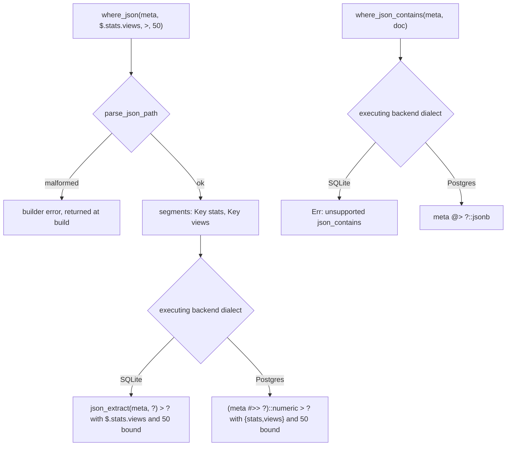

# JSON path queries

Query *inside* JSON columns through the builder — document-store mode for
data whose schema isn't known up front (agent-authored payloads, flexible
metadata).

```rust
// WHERE inside the document, typed comparison:
let hot = db.select(
    &QueryBuilder::table("docs")
        .where_json("meta", "$.stats.views", ">", Value::Int(50)),
)?;

// Project a path out as a column:
let rows = db.select(
    &QueryBuilder::table("docs")
        .select(&["id"])
        .select_json("meta", "$.author.name", "author"),
)?;

// Containment (Postgres only): does the doc contain this subdocument?
let posts = db.select(
    &QueryBuilder::table("docs")
        .where_json_contains("meta", Json::obj(vec![("kind", Json::str("post"))])),
)?;
```

## The path grammar

`$.key.nested[0].deeper` — identifier keys (`[A-Za-z_][A-Za-z0-9_]*`) and
`[n]` array indexes. Deliberately a subset: exotic keys need per-engine
quoting rules; identifiers compile everywhere. Malformed paths are **builder
errors**, and the compiled path is always **bound as a parameter**, never
spliced into SQL.

## Per-dialect compilation

The builder stores parsed segments; the executing backend compiles them —
the first builder feature whose SQL *shape* differs per engine
(`build_for(dialect)` exists for direct callers; `build()` stays the
canonical SQLite form).



| | SQLite (JSON1) | Postgres (jsonb) |
|---|---|---|
| extract | `json_extract(col, ?)` — typed values | `col #>> ?` — text, cast by the value's type (`::numeric` for Int/Real so `9 < 10` compares as numbers, `::boolean` for Bool) |
| path param | `$.a.b[0]` | `{a,b,0}` text-array literal |
| containment | — (`json_contains: false`, errors honestly) | `col @> ?::jsonb` |

Check `capabilities().json_path` / `json_contains` before reaching for these
on an unknown backend; gated backends error with `unsupported: …` before any
SQL is sent.

## Notes

- Store documents with `Value::Json` into a `ColType::Json` column (jsonb on
  Postgres, TEXT on SQLite).
- A jsonb **GIN index** for `@>`-heavy tables isn't emitted by migrations yet
  — the schema IR learns non-btree index kinds with the FTS milestone. Add
  one manually if containment gets hot: `CREATE INDEX ON docs USING GIN (meta)`.
