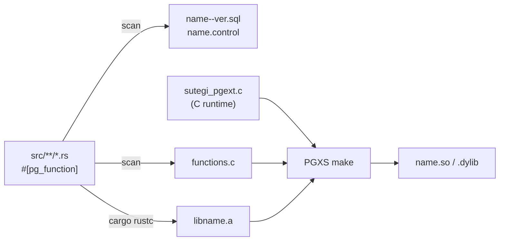

# PostgreSQL extensions in Rust

> [!WARNING]
> `sutegi-pgext` is **experimental**. An extension runs inside the database
> server: a bug in it, or in the generated glue, can crash a backend or
> corrupt data. Test against a throwaway cluster before loading it anywhere
> that matters.

`sutegi-pgext` builds PostgreSQL extensions from a plain Rust crate. Functions
marked `#[pg_function]` become SQL functions; `sutegi pgext build` generates
everything else: the C glue, the `CREATE FUNCTION` script and the control file.
The extension is linked with the server's own PGXS. It's sutegi's take on
[gopgext](https://github.com/jespino/gopgext), which does the same for Go via
TinyGo. As in the rest of sutegi, there's no bindgen, no `cc` crate and no
third-party runtime crates.

```sh
sutegi pgext new hello          # hello/Cargo.toml, src/lib.rs, test.sql
sutegi pgext install hello      # cargo + PGXS: hello.so/.dylib, hello.control, hello--0.1.0.sql
psql -c 'CREATE EXTENSION hello' -c "SELECT hello('world')"
#     hello
# ---------------
#  Hello, world!
```

```rust
use sutegi_pgext::{Error, Result, SetOf, SqlState, pg_function, spi};

/// Returns a greeting for name.
#[pg_function(immutable, parallel_safe)]
fn hello(name: &str) -> String {
    format!("Hello, {name}!")
}

/// Divides a by b, raising division_by_zero instead of panicking.
#[pg_function(immutable, parallel_safe)]
fn safe_div(a: i64, b: i64) -> Result<i64> {
    a.checked_div(b).ok_or_else(|| {
        Error::new(SqlState::DIVISION_BY_ZERO, "division by zero").hint("Pass a non-zero divisor.")
    })
}

/// Counts from 1 to n, streaming the rows.
#[pg_function(immutable, rows = 10)]
fn count_to(n: i64) -> SetOf<i64> {
    SetOf::new(1..=n)
}

/// Counts the rows of items above a price, through SPI.
#[pg_function(stable)]
fn expensive(min: i32) -> Result<i64> {
    let n = spi::query_scalar("SELECT count(*) FROM items WHERE price > $1", &[&min])?;
    Ok(n.as_deref().unwrap_or("0").parse()?)
}
```

Requirements: Rust, PostgreSQL 14 or later with its server development files
(`pg_config`, headers, PGXS), `make` and a C compiler. Tested on macOS
(arm64) and Linux (x86-64).

## Commands

| Command | What it does |
|---|---|
| `sutegi pgext new <dir> [--path <sutegi checkout>]` | Scaffolds a `staticlib` crate with three example functions and a `test.sql`. |
| `sutegi pgext build [dir] [--pg-config <path>] [--debug]` | Builds the extension into `<target>/sutegi-pgext/<name>/`. |
| `sutegi pgext install [dir] [--pg-config <path>] [--debug]` | Builds, then runs `make install` for that server. |

`--pg-config` defaults to `$PG_CONFIG`, then to `pg_config` on `PATH`. The
extension's name is the crate name with `-` changed to `_`. Its version is the
crate version. The control file's comment is the crate description. SQL files
under `sql/` are appended to the install script in name order, after the
generated functions. Use them for tables, views, casts and anything else
that's plain SQL.

## SQL functions

| Rust | SQL |
|---|---|
| `bool` | `boolean` |
| `i16` / `i32` / `i64` | `smallint` / `integer` / `bigint` |
| `f32` / `f64` | `real` / `double precision` |
| `&str` / `String` | `text` |
| `&[u8]` / `Vec<u8>` | `bytea` |
| `Option<T>` | `T`; `NULL` ⇄ `None` |
| `()` (result) | `void` |
| `SetOf<T>` (result) | `SETOF T` (`T` may be an `Option`) |
| `Result<T, E>` (result) | `T`; an `Err` raises an `ERROR` (`E` is `Error` or any `std::error::Error`) |

- **Strictness follows the signature.** A function without `Option`
  parameters is `STRICT`: PostgreSQL returns `NULL` without calling it. With
  an `Option` parameter it's called on `NULL` input. A `NULL` reaching a
  non-`Option` parameter then raises `null_value_not_allowed`.
- **Borrowed arguments are free.** `&str` and `&[u8]` point into the detoasted
  datum and live until the function returns. Text must be valid UTF-8, so the
  database must be `UTF8` (or `SQL_ASCII`). In any other encoding a function
  taking or returning text raises `feature_not_supported`.
- **Options**: `immutable` / `stable` / `volatile` (default), `parallel_safe` /
  `parallel_restricted` / `parallel_unsafe`, `leakproof`,
  `security_definer`, `name = "sql_name"`, `cost = N`, `rows = N` (sets only).
  An unknown option is a compile error.
- **`security_definer` pins `search_path`** to `pg_catalog, pg_temp`. The
  function runs SPI queries with its owner's rights, and without a fixed
  path a caller could shadow a table, function or operator with one in a
  schema they control. Schema-qualify everything such a function queries.
- **Sets stream.** `SetOf::new(iter)` pulls rows one at a time into
  PostgreSQL's tuplestore, which spills to disk past `work_mem`, and checks
  for cancellation every 1024 rows. A huge or endless set never sits in Rust
  memory. `collect()` and `SetOf::from(vec)` build the rows first; use them
  when rows borrow from the arguments.
- **Text can't contain NUL.** Returning a string with `\0` raises
  `character_not_in_repertoire`, as PostgreSQL's own text input does.
- **Doc comments** become `COMMENT ON FUNCTION`.
- A function can live in any module; each Rust function name must be unique
  across the crate.

## Errors

`Error::new(SqlState::X, "message").detail("…").hint("…")` reports an `ERROR`
with that SQLSTATE once the function returns. Any `std::error::Error`
converts with `?` and gets SQLSTATE `P0001`, like PL/pgSQL's `RAISE`. A
**panic** is caught at the boundary and reported as `internal_error` (`Rust
panic in <fn>: <message>`). The backend keeps running.

PostgreSQL errors raised while Rust is running, such as a failing SPI query or
a cancel, come back as an `Err` with `is_postgres_error()` set. Propagate it.
The call is now poisoned: every later PostgreSQL operation fails at once, and
the original error (`undefined_table`, `query_canceled`, ...) is re-raised
unchanged even if the function swallows it and returns `Ok`.

Two failures can't be turned into an `ERROR`, because Rust can't unwind out
of them:

- **Out of memory.** Rust aborts the process when an allocation fails, and
  PostgreSQL treats a backend killed by a signal as a crash: it resets every
  session and replays WAL. So sutegi-pgext installs a global allocator that
  raises `FATAL: out of memory` instead. Only that session ends, through the
  normal exit path. An extension can't define its own
  `#[global_allocator]`.
- **Stack overflow.** Deep recursion in pure Rust overflows the stack
  (`SIGSEGV`, a crash) before PostgreSQL ever checks it. Call
  `sutegi_pgext::check_stack_depth()?` at the top of a recursive function:
  it fails with `stack depth limit exceeded` (`54001`) once
  `max_stack_depth` is reached.

A panic needs `panic = "unwind"` to become an `ERROR`. A crate built with
`panic = "abort"` fails to compile against sutegi-pgext.

## SPI, logging, interrupts

- `spi::query(sql, &[&a, &b])` returns `Rows` (every value as text, with
  column names), `spi::query_scalar`, `spi::query_limit`, and `spi::execute`
  (rows processed). Parameters are always bound (`$1`, `$2`, …) from typed
  Rust values. Queries run read-only when the calling function is `IMMUTABLE`
  or `STABLE`. A query may call back into the same extension.
- `query_scalar` runs the statement to completion and returns the first
  value. `query_limit(sql, params, n)` stops after `n` rows, like `LIMIT`,
  and that includes `INSERT … RETURNING`, which then writes at most `n` rows.
- Each query's copy of its result is freed as soon as Rust has read it, so a
  loop of a million queries runs in constant memory.
- `notice`, `info`, `warning`, `log`, `debug` emit at that level.
- `check_for_interrupts()` belongs in long loops: on cancel or
  `statement_timeout` it returns the cancel error.

## How it works



1. `cargo metadata` locates the crate's library target.
2. The build scans every `.rs` file under the lib's directory for
   `#[pg_function]`. It maps each signature to SQL, much as gopgext's `go/ast`
   pass does. On the Rust side, the attribute macro emits an `extern "C"`
   wrapper (`sutegi_pgext_fn_<name>`) that reads each argument through
   `FromArg` and hands the result back through `IntoReturn`.
3. `cargo rustc` builds the static library and prints the native libraries
   Rust's std needs. `nm` then checks that every scanned function was
   compiled: a `#[pg_function]` in a module that isn't declared, or is
   `cfg`'d out, fails the build here instead of at `CREATE EXTENSION`.
4. The work dir receives the C runtime, a generated `functions.c` (one
   `PG_FUNCTION_INFO_V1` per function, each calling
   `sx_invoke(fcinfo, sutegi_pgext_fn_<name>)`), the export list, the control
   file, the install script and a Makefile.
5. PGXS compiles and links `<name>.so` with the server's own flags. The
   export list keeps only `Pg_magic_func`, `_PG_init` and the SQL functions
   global. The C runtime and all of Rust stay local, so several sutegi-pgext
   extensions can share a backend (`examples/pgext-mini` tests this). The
   module is relinked whenever the Rust library changes.

**The runtime model.** A backend is single-threaded, so Rust runs on its stack
only while PostgreSQL calls in. PostgreSQL raises errors with `siglongjmp`,
and that must never unwind a Rust frame. So Rust never calls PostgreSQL
directly: it holds an opaque call handle and moves values through one
`#[repr(C)]` struct (`csrc/sutegi_pgext.h`). Every C helper that can raise
wraps its work in `PG_TRY`. On error it parks a copy of the error on the call
and returns `false`, Rust unwinds normally, and `sx_invoke` re-throws the
parked error after Rust has returned. Arguments are type-checked against the
calling expression (`get_fn_expr_argtype`), so a stale install script fails
with `datatype_mismatch` instead of misreading a datum. Results are copied into
`palloc` memory, and set rows into a tuplestore (materialize mode), before
Rust's values are dropped. Each set row is converted in a short-lived memory
context that's reset once the tuplestore has its copy.

## Testing

`scripts/pgext-test.sh [pg_config] [project ...]` builds and installs every
project first (default `examples/pgext-demo` and `examples/pgext-mini`), so a
test may load several extensions. Set `PGEXT_SUDO=sudo` when the server's
directories need root. The script then starts a throwaway cluster and runs
every `test*.sql` in its own database with `ON_ERROR_STOP`, and tests assert
by raising. A `test-latin1*.sql` runs in a `LATIN1` database. A `*.fatal.sql`
must end its own session with a `FATAL` (psql exit 2) while the server stays
up. Any `TRAP:`/`PANIC:`/crashed backend in the server log fails the run. CI
runs it against PostgreSQL 17.

The Rust side (marshalling, errors, sets, SPI, the scanner and the code
generator) is unit-tested without a server. Under `cargo test` a Rust stand-in
replaces the C runtime and keeps its contract: a failing helper parks an error
and poisons the call.

## Limitations

- Scalar types only so far: no arrays, composite/row results, custom types,
  `numeric`, `timestamp`, `jsonb` or `uuid`. Pass those as `text` and cast in
  SQL.
- No triggers, aggregates, operators, index support functions, hooks or
  background workers yet. gopgext's framework packages are the roadmap.
- SPI results are text, and `query` holds one whole result in memory (in
  PostgreSQL and then in Rust). Use `query_limit` or a cursor-sized `LIMIT`
  for big tables.
- No user `_PG_init` hook, GUCs or shared memory.
- Don't touch sutegi-pgext from threads you spawn. PostgreSQL isn't
  thread-safe, and every helper fails outside a SQL function call.
- On Linux with memory overcommit, an allocation can succeed and the kernel's
  OOM killer can later `SIGKILL` the backend, which is a crash. The same is
  true of C extensions.
- A panic while already panicking (in a `Drop` during unwinding) aborts the
  process, which is a crash.
