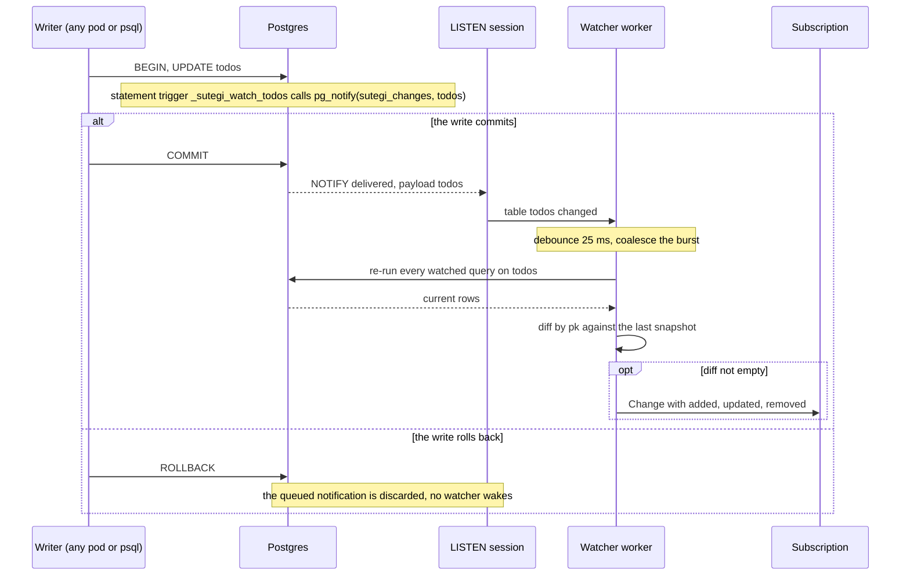

# Reactive queries

`watch(query)` → the current result plus **pushed diffs** whenever the data
changes. The primitive that unifies LISTEN/NOTIFY, the event-store wakeups,
and PgPubSub into one shape — and turns a channel topic into a live query.

```rust
use sutegi_orm::watch::Watcher;

let watcher = Watcher::postgres(&pg)?;            // one per process
let sub = watcher.watch(
    QueryBuilder::table("todos").filter("done", "=", Value::Bool(false)),
    "id",
)?;

for row in sub.rows() { /* the result at watch time */ }
while let Some(change) = sub.recv_timeout(Duration::from_secs(30)) {
    // Change { table, added, updated, removed } — only when the watched
    // result actually moved.
    hub.broadcast("todos:lobby", change.to_json()); // → channels → browsers
}
```

## Scope — check `capabilities().live_queries`

| backend | scope | change detection |
|---------|-------|------------------|
| Postgres | `cluster` — any pod's committed write wakes every pod's watchers | statement-level `_sutegi_watch_<t>` trigger → `pg_notify('sutegi_changes', table)` → a dedicated LISTEN session per `Watcher` |
| SQLite | `process` — this process's pool only | `update_hook` on every pooled connection |

- **Postgres**: `watch()` installs the trigger idempotently. NOTIFY is
  transactional — a rolled-back write never fires (tested). Writes from
  *anywhere* count, including psql: the trigger is in the database, not the
  framework. Triggers/functions are `_sutegi_`-named and invisible to
  introspection/`migrate:drift`.
- **SQLite**: writes from other processes on the same file are invisible —
  believe the capability. Attach the watcher before serving traffic (a
  connection checked out across the attach instant picks the hook up on its
  next checkout).

## Semantics: table-coarse requery-diff (v1)

On a change to a watched table — debounced 25ms, bursts coalesced — each
watcher re-runs its query and diffs by pk:

- new pk → `added`; pk gone → `removed`; same pk, different row → `updated`
- a write that doesn't move the watched result emits **nothing** (an insert
  outside the filter, an update to an unwatched column set… the requery runs,
  the diff is empty, nothing is sent)
- the pk column must be part of the watched selection (the diff keys on it)



Guardrails: 1024 live subscriptions per `Watcher` (then `watch()` errors);
one requery per table per debounce window regardless of burst size (20
writes → typically 1 `Change` carrying all 20 rows, tested). Row-level
trigger payloads are the v2 escape hatch if requery cost ever bites.

## Lifecycle

One `Watcher` per process per backend handle. Dropping a `Subscription`
unregisters it; dropping the `Watcher` shuts down the worker (and interrupts
the blocked LISTEN session on Postgres).
