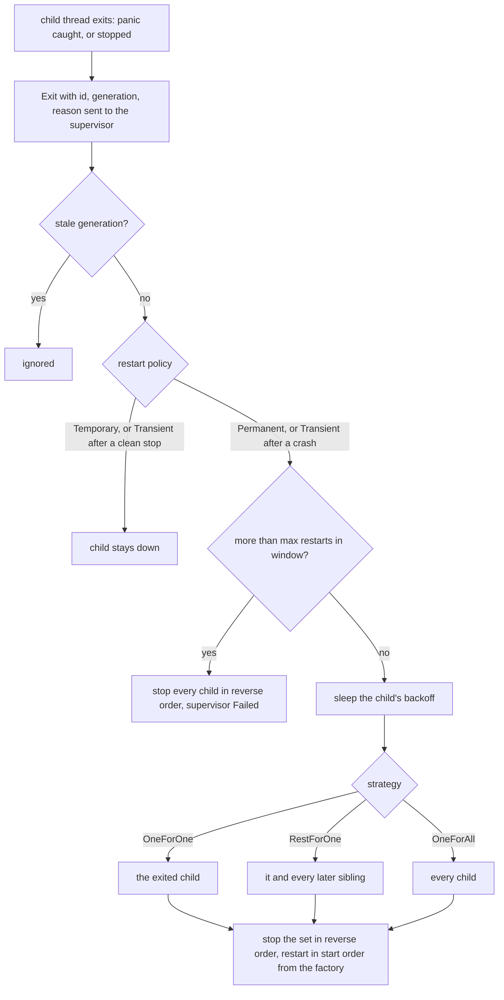

<!-- Generated from landing/src/Docs.svelte. Run: cd landing && pnpm docs:export -->

[← Queues](queues.md) · [Documentation index](../README.md) · [File storage →](storage.md)

# Actors & supervision

The `actors` feature is the OTP half of the stack: isolated processes with typed mailboxes, and supervision trees that restart them when they crash. An `Actor` owns its state outright on its own thread — no locks, no `Sync` bound on the state — and other threads communicate by message through an `ActorRef`.

```rust
use sutegi::prelude::*;

struct Counter { n: u64 }
enum Msg { Bump, Get(ReplyTo<u64>) }

impl Actor for Counter {
    type Msg = Msg;
    fn handle(&mut self, msg: Msg) {
        match msg {
            Msg::Bump => self.n += 1,
            Msg::Get(reply) => reply.reply(self.n),
        }
    }
}

let counter = spawn(Counter { n: 0 });
counter.tell(Msg::Bump)?;                                  // cast; TellError::Full = backpressure
let n = counter.ask(Msg::Get, Duration::from_secs(1))?;    // call

// OTP-style supervision: the factory re-runs on restart, so a crashed child
// comes back as a FRESH value — never with the state it died holding.
let sup = Supervisor::new("pipeline")
    .strategy(Strategy::OneForOne)          // RestForOne | OneForAll
    .intensity(3, Duration::from_secs(5))   // exceeded -> stop all, Failed
    .child(ChildSpec::new("worker-1", || Worker::new()))
    .child(ChildSpec::new("flaky-api", || ApiClient::new())
        .restart(Restart::Transient)        // Permanent | Transient | Temporary
        .backoff(Duration::from_millis(250)))
    .start();

App::new("myapp").actors(sup.registry()).serve()?;   // GET /__actors
```



*What the supervisor does with each child exit: restart policy, then the intensity cap, then the strategy picks which children restart.*

- **Bounded mailbox** (default 1024): a full mailbox fails `tell` fast with `TellError::Full`, so backpressure is explicit rather than a hidden unbounded queue.
- **Let it crash.** A panic in `handle` kills only that actor and is reported as `ExitReason::Crashed`. Lifecycle hooks `started()` / `stopped(&reason)` run on every (re)start and exit. `stop()` is queued behind pending messages, so the mailbox drains first.
- **Restart intensity** (default 3 per 5 s) fails the supervisor and stops all children when exceeded, so a crash-looping child cannot burn a thread forever. `RestForOne`/`OneForAll` stop dependents in reverse order and restart them in start order.
- `SupervisorHandle::child_ref(name)` is the `whereis` analog — re-fetch after a crash, because an old ref points at the dead generation’s queue. `start()` returns only once every child’s first generation is up.
- `App::actors(registry)` mounts `GET /__actors`: state, mailbox depth, restart counts and last crash message per actor — the Observer-lite half of the agent contract, `ops_guard`-gated like the rest.

> [!WARNING]
> **One OS thread per actor**
>
> This is supervision and fault isolation, not BEAM-scale lightweight processes: thousands of actors, not millions. There are no links or monitors beyond the supervisor relationship, no distribution (Postgres is the bus), and no hot code reload. Supervision rests on `catch_unwind`, so it needs `panic = "unwind"` (the Rust default): an app that sets `panic = "abort"` turns every actor crash into a process exit.

> [!TIP]
> **Deep dive:** [the long-form guide](../ACTORS.md), with every option and edge case.

---

[← Queues](queues.md) · [Documentation index](../README.md) · [File storage →](storage.md)
