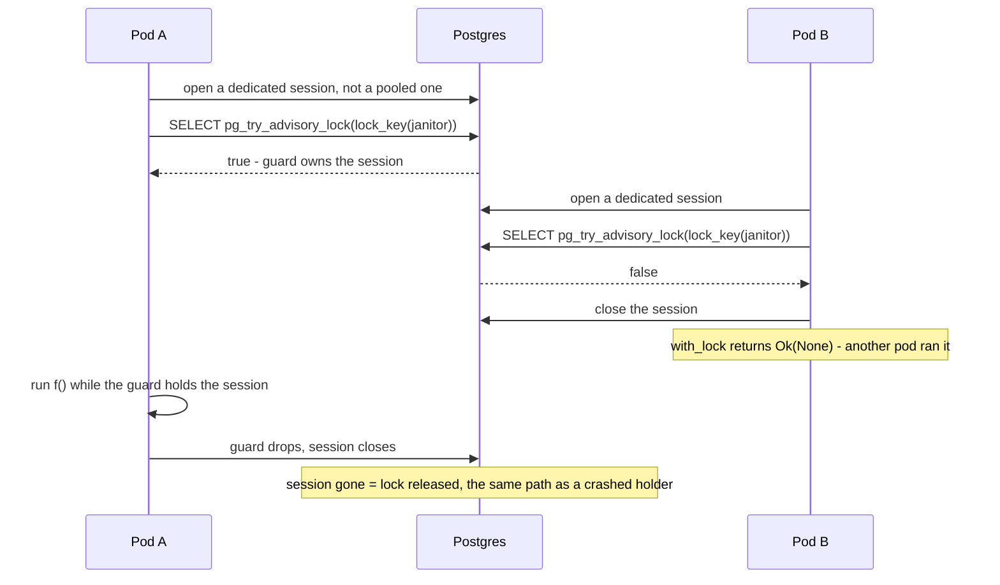

<!-- Generated from landing/src/Docs.svelte. Run: cd landing && pnpm docs:export -->

[← Locks, isolation, bulk](concurrency.md) · [Documentation index](../README.md) · [JSON path queries →](json.md)

# Advisory locks

Named locks are the coordination primitive for “exactly one of us”: singleton jobs, janitors, leader election, a migration mutex. `try_lock` returns an RAII `LockGuard`; `with_lock` is the singleton-job shape, where `Ok(None)` means another pod ran it.

```rust
use std::time::Duration;

// Try once; None = someone else holds it.
if let Some(_guard) = db.try_lock("nightly-report")? {
    run_report(&db)?;
}   // dropping the guard releases

// Wait up to 5s, then give up.
let guard = db.lock("reindex", Duration::from_secs(5))?;

// The singleton-job shape: at most one pod runs f. Ok(None) = another pod did.
db.with_lock("janitor", Duration::ZERO, || sweep(&db))?;

// Leader election — hold it for the process lifetime; followers retry.
std::thread::spawn(move || loop {
    if let Ok(Some(_leader)) = db.try_lock("scheduler-leader") {
        run_scheduler(&db);       // returns only if the scheduler stops
    }
    std::thread::sleep(Duration::from_secs(5));
});

// An operator can take the same lock from psql:
//   SELECT pg_try_advisory_lock(<sutegi_orm::lock_key("scheduler-leader")>);
```



*Two pods race with\_lock("janitor", Duration::ZERO, …): one wins and holds the lock on its own session; the loser gets Ok(None).*

- **Postgres is cluster-scoped** via `pg_try_advisory_lock` on a *dedicated* session — never a pooled connection, so a leader lock held for the process lifetime cannot starve request traffic. Release is closing that session, which is exactly what the server does when a holder crashes, so crash-release needs no cleanup path.
- **SQLite is process-scoped**: a named-mutex registry keyed per database file. Two OS processes on the same file do *not* contend — believe the capability.
- Inside a Postgres transaction, `try_lock` is transaction-scoped (`pg_try_advisory_xact_lock`) and releases at COMMIT, **not** at guard drop.
- `with_lock` reconnects per call on Postgres — fine for a janitor loop, wrong in a request hot path. These are for coordination, not thousands of concurrent holds.

> [!TIP]
> **Deep dive:** [the long-form guide](../LOCKS.md), with every option and edge case.

---

[← Locks, isolation, bulk](concurrency.md) · [Documentation index](../README.md) · [JSON path queries →](json.md)
