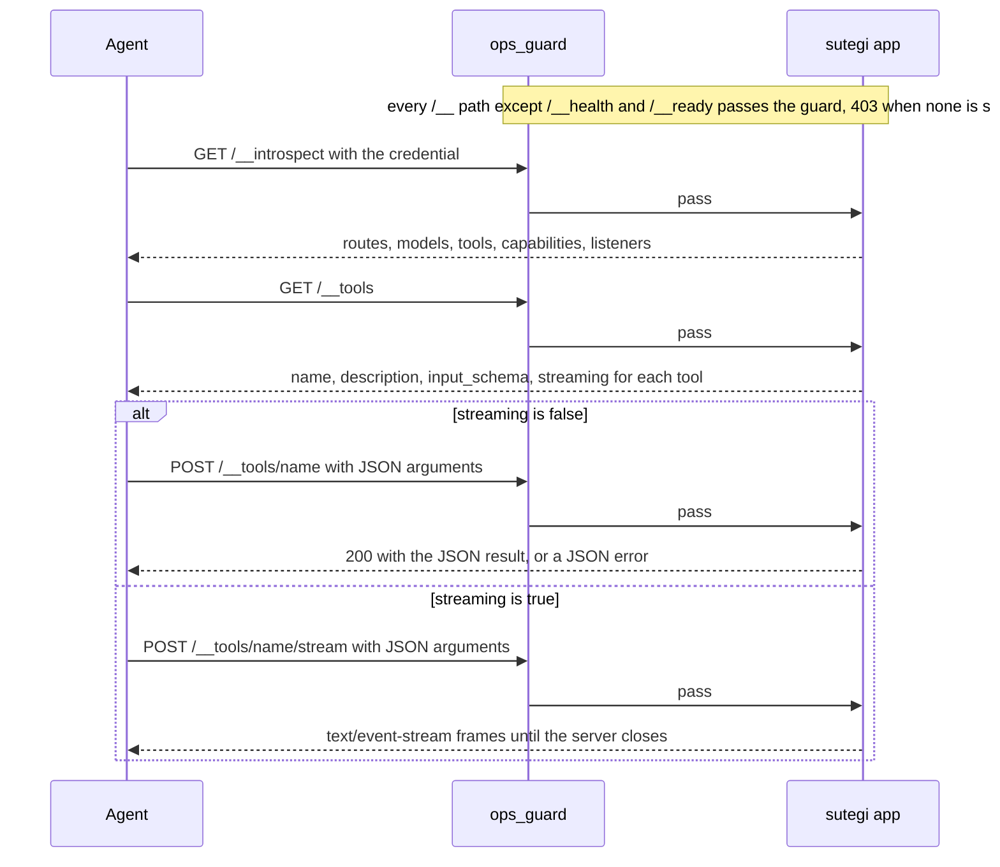

<!-- Generated from landing/src/Docs.svelte. Run: cd landing && pnpm docs:export -->

[← Relations](relations.md) · [Documentation index](../README.md) · [Defining tools →](tools.md)

# The agent surface

Because every route, model, tool, capability and searchable table registers its own metadata, sutegi exposes your whole app as machine-readable JSON with no extra work. `/__introspect` returns the full surface; an agent reads it once, then calls tools through `/__tools`. There is no SDK and no source access required: the app you built for humans is the app the model drives.

```bash
# For the included demo: OPS_TOKEN=dev-token cargo run -p todo-example
# For your own app, configure .ops_guard(bearer(&ops_token)) first.
AUTH="Authorization: Bearer dev-token"
curl -H "$AUTH" localhost:8080/__introspect
# {
#   "framework": "sutegi", "version": "0.16.0", "name": "todo",
#   "routes": [ { "method": "GET", "pattern": "/todos/:id", "doc": "…" } ],
#   "models": [ … ], "tools": [ … ],
#   "capabilities": { "backend": "postgres", "skip_locked": true, … },
#   "search": [ { "table": "docs", "columns": ["title","body"] } ],
#   "listeners": [ { "name": "statsd", "doc": "Ingests statsd on udp/8125." } ],
#   "endpoints": { "introspect": "/__introspect", "health": "/__health",
#                  "ready": "/__ready", "metrics": "/__metrics" }
# }

curl -H "$AUTH" localhost:8080/__tools
# [ { "name": "create_todo", "description": "…", "input_schema": {…}, "streaming": false } ]

curl -H "$AUTH" -H 'Content-Type: application/json' -X POST localhost:8080/__tools/create_todo -d '{"title":"ship sutegi"}'
# args are validated against the tool's schema -> 422 on a bad shape
```

The contract is three steps — discover (`/__introspect`), read the manifest (`/__tools`), invoke (`POST /__tools/:name`, or `/__tools/:name/stream` for SSE) — and it is extended, not replaced, by the realtime surfaces: `/__channels` teaches an agent the channel protocol, `/__actors` shows live process status. Everything under `/__` except the two probes sits behind [`ops_guard`](middleware.md).



*The agent contract: discover, read the manifest, then invoke the unary or the streaming endpoint, all behind ops\_guard.*

> [!NOTE]
> **The full contract**
>
> [AGENTS.md](../../AGENTS.md) specifies the complete discover / manifest / invoke / stream protocol.

---

[← Relations](relations.md) · [Documentation index](../README.md) · [Defining tools →](tools.md)
