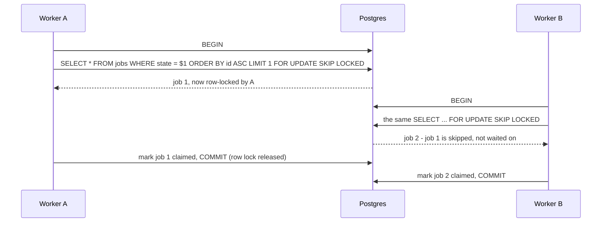
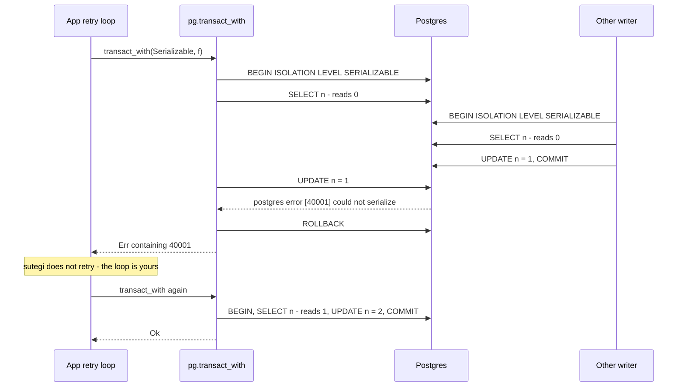

<!-- Generated from landing/src/Docs.svelte. Run: cd landing && pnpm docs:export -->

[← Migrations](migrations.md) · [Documentation index](../README.md) · [Advisory locks →](advisory.md)

# Locks, isolation, bulk

Four throughput and correctness primitives, all through the same `Backend` seam and all gated on the capability bits above.

```rust
// Row locks — the work-queue claim shape (Postgres; see the matrix above).
db.transact(|tx| {
    let claimed = tx.select(
        &QueryBuilder::table("jobs")
            .filter("state", "=", "ready".into())
            .order_by("id", false)
            .limit(1)
            .for_update()          // or .for_share()
            .skip_locked(),        // or .nowait()
    )?;
    Ok(claimed)
})?;

// Isolation levels — a lost-update race surfaces as PG error 40001, so retry.
db.transact_with(Isolation::Serializable, |tx| {
    let n = read_counter(tx)?;
    tx.execute("UPDATE counters SET n = ? WHERE id = 1", &[(n + 1).into()])
})?;

// RETURNING on DML — the affected rows in one round-trip.
let rows = db.update_returning(
    &UpdateBuilder::table("todos")
        .set("done", true.into())
        .filter("id", "=", 7.into())
        .returning(&["id", "title", "done"]),
)?;

// Bulk insert — multi-row VALUES anywhere, wire-native COPY on Postgres
// (measured 30.8x faster than row-at-a-time at 5k rows).
let n = db.insert_many("events", &["id", "kind", "payload"], &rows)?;
```



*With SKIP LOCKED, two workers running the same claim query take different rows instead of queueing behind each other.*



*A serializable lost-update race fails with 40001 and transact\_with rolls back; the retry loop is yours, not the framework's.*

- **Row locks.** The builder stores the request; the executing backend emits it. Postgres emits `FOR UPDATE [SKIP LOCKED|NOWAIT]`. SQLite treats plain `for_update`/`for_share` as a no-op — its write transaction already holds the whole database, strictly coarser — but `skip_locked`/`nowait` *error*: altered contention semantics are the point, and SQLite cannot express them.
- **Isolation.** Postgres gets `BEGIN ISOLATION LEVEL …`. SQLite is always serializable, so levels map to when the write lock is taken (`Serializable` → `BEGIN EXCLUSIVE`, `RepeatableRead` → `BEGIN IMMEDIATE`, `ReadCommitted` → `BEGIN`) — stronger than asked is honest, weaker would not be.
- **RETURNING on DML.** Same syntax on both engines (SQLite ≥ 3.35; the bundled build is newer), routed through `query` so the rows come back.
- **Bulk insert.** The default batches multi-row `INSERT … VALUES` under the placeholder budget on any backend; outside a transaction, Postgres overrides it with wire-native `COPY FROM STDIN`, with tabs, newlines, backslashes and NULLs escaped correctly (hostile content round-trips in the tests).

> [!TIP]
> **Deep dive:** [the long-form guide](../CONCURRENCY.md), with every option and edge case.

---

[← Migrations](migrations.md) · [Documentation index](../README.md) · [Advisory locks →](advisory.md)
