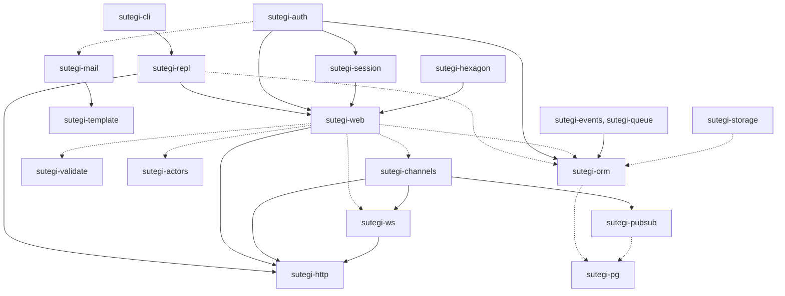

<!-- Generated from landing/src/Docs.svelte. Run: cd landing && pnpm docs:export -->

[← Request lifecycle](internals.md) · [Documentation index](../README.md) · [Hexagonal architecture →](hexagonal.md)

# The workspace map

sutegi is one facade crate over twenty-odd small ones. You depend on `sutegi` and switch features on; the table is here so you know what you are reading when you open the source, and so an error message from `sutegi_orm` or `sutegi_pg` tells you where to look.

*Internal dependencies between workspace crates; dotted edges are optional. sutegi-json, sutegi-crypto and sutegi-log, used almost everywhere, are left out.*

| Crate | Feature | Responsibility |
| --- | --- | --- |
| `sutegi-json` | core | JSON value, parser, serializer (deterministic key order). |
| `sutegi-http` | core | HTTP/1.1 parsing + the blocking thread-pool server on `std::net`. |
| `sutegi-web` | core | Router, `App`, middleware, groups, streaming, static files, `/__introspect`, and the whole agent tool surface. |
| `sutegi-crypto` | core | SHA-256/1, MD5, HMAC, PBKDF2, HKDF, ChaCha20-Poly1305, base64, CSPRNG. |
| `sutegi-orm` | `orm` | Schema IR, query builder, the `Backend` trait, migrations/diff, KV, JSON paths, search, embeddings, watchers, and the two runnable backends. |
| `sutegi-pg` | `postgres` | Pure-`std` PostgreSQL driver: wire protocol v3, SCRAM-SHA-256, COPY, LISTEN, pool. |
| `sutegi-macros` | `derive` | `#[derive(Model)]` / `#[derive(Validate)]`. Build-time only — syn/quote never reach your binary. |
| `sutegi-validate` | `validate` | Rulesets *and* a JSON Schema subset validator, one structured error shape. |
| `sutegi-queue` | `queue` | Durable job queue over the `Backend` seam. |
| `sutegi-events` | `events` | Append-only event store, aggregates, checkpointed projections. |
| `sutegi-ws` | `ws` | RFC 6455 codec + the sharded kqueue/epoll reactor. |
| `sutegi-pubsub` | `pubsub` | The `Broker` seam: in-process, or `PgPubSub` over LISTEN/NOTIFY. |
| `sutegi-channels` | `channels` | Phoenix-style channels, presence, the `/__channels` manifest, the JS client. |
| `sutegi-actors` | `actors` | Actor processes, OTP-style supervision trees, `/__actors`. |
| `sutegi-session` | `session` | Signed-cookie sessions + CSRF tokens. |
| `sutegi-auth` | `auth` | Users, passwords, guards, API tokens, remember-me, throttling, verification/reset. |
| `sutegi-mail` | `mail` | `Email` builder, RFC 2822/MIME rendering, themed messages, the `Transport` seam. |
| `sutegi-template` | `template` | Blade-lite engine over `Json` contexts. |
| `sutegi-storage` | `storage` | The `Storage` trait: local fs, DB blobs, S3/R2 + SigV4, over an injected HTTP transport. |
| `sutegi-hexagon` | `hexagon` | Ports & adapters primitives: `UseCase`, `AppError`, `respond`. |
| `sutegi-repl` | `repl` | The tinker-style shell, in-process or over the wire. |
| `sutegi-cli` | binary | The `sutegi` command: scaffold, introspect, repl. |

---

[← Request lifecycle](internals.md) · [Documentation index](../README.md) · [Hexagonal architecture →](hexagonal.md)
