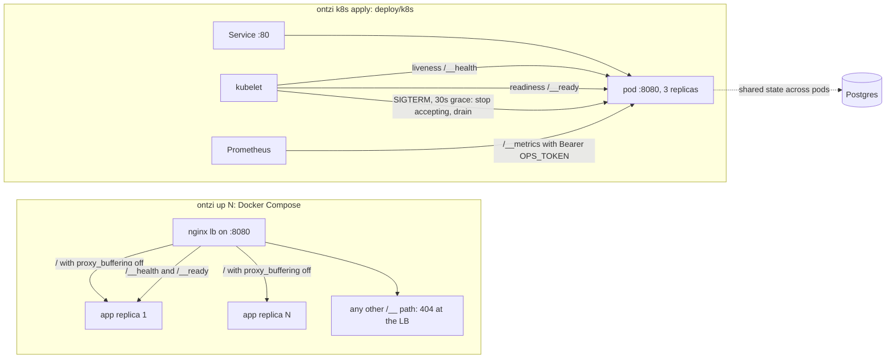

<!-- Generated from landing/src/Docs.svelte. Run: cd landing && pnpm docs:export -->

[← Directory structure](layout.md) · [Documentation index](../README.md) · [Request lifecycle →](internals.md)

# Deploying

With the `graceful` feature, `.serve()` does the right thing for a rolling update: it traps SIGTERM/SIGINT, stops accepting new connections, and drains in-flight requests before exiting. (`run(addr)` serves forever and `run_until(addr, flag)` gives manual control without the signal feature.) `ontzi` (Basque: *vessel*) wraps Docker Compose to run the horizontally-scaled shape locally — N replicas behind an nginx load balancer configured with `proxy_buffering off` so SSE streams pass straight through — and promotes the same shape to Kubernetes with manifests that already wire probes, graceful drain and Prometheus annotations. For a single box, a provisioning script installs the binary as a hardened systemd unit behind nginx instead.

```bash
./ontzi up 3            # 3 replicas behind an nginx LB on http://localhost:8080
./ontzi curl /api/todos
./ontzi logs
./ontzi down
./ontzi k8s apply      # promote deploy/k8s/ — probes, drain, Prometheus annotations wired
```



*The same shape locally under ontzi (replicas behind nginx) and on Kubernetes (probes, SIGTERM drain, authenticated metrics scrape).*

Pick the backend for the deployment, not the code: one instance runs on SQLite (embedded, zero-ops); many pods run on Postgres, which is also what turns the queue’s exclusivity, the advisory locks, the watchers and the channel broker from process-scoped into cluster-scoped. The request surface is stateless and scales horizontally either way, and the binary is small enough that `requests: 32Mi` is a reasonable ask.

---

[← Directory structure](layout.md) · [Documentation index](../README.md) · [Request lifecycle →](internals.md)
