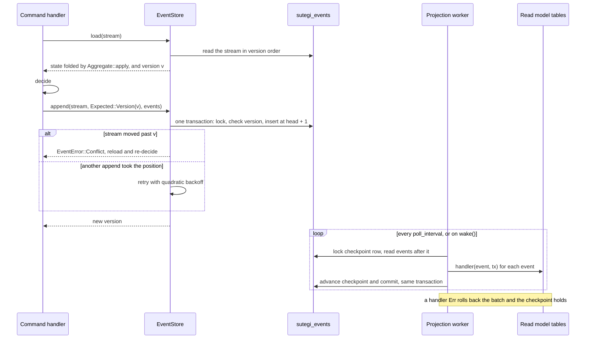

<!-- Generated from landing/src/Docs.svelte. Run: cd landing && pnpm docs:export -->

[← Collections](collections.md) · [Documentation index](../README.md) · [Mail →](mail.md)

# Event sourcing

The `events` feature is an append-only event store over the `Backend` seam. You `append` events to a per-entity stream with an `Expected` version for optimistic concurrency (`Any`, `NoStream`, or `Version(n)`), and fold current state back on demand by implementing `Aggregate::apply`. Global log positions are gap-free.

```rust
use sutegi::events::{event, Aggregate, EventStore, Expected, Projections, StoredEvent};

#[derive(Default)]
struct Account { balance: i64 }

impl Aggregate for Account {
    fn apply(&mut self, e: &StoredEvent) {
        let amount = e.payload.get("amount").and_then(Json::as_i64).unwrap_or(0);
        match e.name.as_str() {
            "deposited" => self.balance += amount,
            "withdrawn" => self.balance -= amount,
            _ => {}
        }
    }
}

let store = EventStore::new(db.clone());
store.migrate()?;

// Append with optimistic concurrency (Any | NoStream | Version(n)):
store.append("account-42", Expected::Any, &[event("deposited", amount_payload(100))])?;
let (account, version) = store.load::<Account>("account-42")?;   // balance = 100
// append_tx composes with a transaction you already own.

// A checkpointed projection maintains a read model, exactly once, rebuildable:
let mut projections = Projections::new(db.clone());
projections.register("account_balances", |e, tx| {
    /* write to a read-model table in the same transaction as the checkpoint */ Ok(())
});
let _workers = std::sync::Arc::new(projections).start();
```



*Load, decide, append with an expected version; projections advance their checkpoint in the same transaction as their read-model writes.*

`Projections` are checkpointed consumers: the handler’s writes and its checkpoint bump commit in one transaction, giving exactly-once read models that you can `reset` and rebuild from the log. `append_tx` composes with a transaction you already own, and position-race retries back off quadratically so a thundering herd cannot exhaust one writer’s retries.

---

[← Collections](collections.md) · [Documentation index](../README.md) · [Mail →](mail.md)
