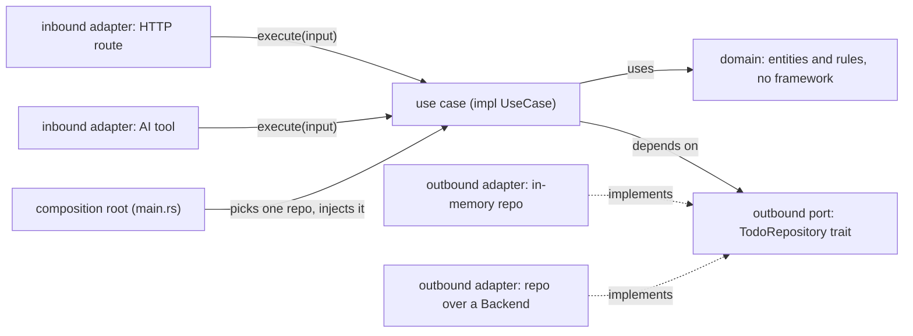

<!-- Generated from landing/src/Docs.svelte. Run: cd landing && pnpm docs:export -->

[← The workspace map](crates.md) · [Documentation index](../README.md) · [Listeners →](listeners.md)

# Hexagonal architecture

As an app grows, the `hexagon` toolkit keeps it honest. Your domain stays pure; the application layer depends on *port* traits (an outbound `TodoRepository`, say); and adapters — an HTTP route, an AI tool, a repo over either `Backend` — plug in at the edges. `UseCase` is the inbound-port trait, `AppError`/`AppResult` are transport-agnostic with a canonical HTTP mapping, and `respond`/`respond_created` are the glue that turns an `AppResult` into a `Response`.

```rust
// Domain use case, written against a port trait — no HTTP, no SQL in sight.
impl UseCase for CreateTodo {
    type Input = String;              // the title
    type Output = Todo;
    fn execute(&self, title: String) -> AppResult<Todo> {
        let todo = Todo::new(title).map_err(AppError::invalid)?;
        let id = self.repo.insert(&todo)?;    // outbound port: Db, Pg, or in-memory
        Ok(Todo { id, ..todo })
    }
}

// Inbound HTTP adapter — respond_created maps AppResult to the right response:
.post("/todos", "Create", move |c| {
    let title = c.json()?.get("title").and_then(Json::as_str).unwrap_or("").to_string();
    respond_created(create.execute(title))
})
// The very same use case can back the AI tool from "Defining tools" — write it once.
```



*Every dependency points inward: two inbound adapters share one use case, and the composition root picks which outbound repo fills the port.*

One use case can back both a route and a tool, over whichever store the composition root injects — and it is fully testable without starting a server. `Command`, `Query`, `Event` and `EventBus` are there when you want the CQRS vocabulary too.

> [!NOTE]
> **Full guide**
>
> [docs/HEXAGONAL.md](../HEXAGONAL.md) covers the dependency rule, layer responsibilities, layout, and testing strategy in depth, and `examples/hexagonal` is a worked reference with two interchangeable repositories (in-memory ↔ SQLite) selected at the composition root.

> [!TIP]
> **Deep dive:** [the long-form guide](../HEXAGONAL.md), with every option and edge case.

---

[← The workspace map](crates.md) · [Documentation index](../README.md) · [Listeners →](listeners.md)
