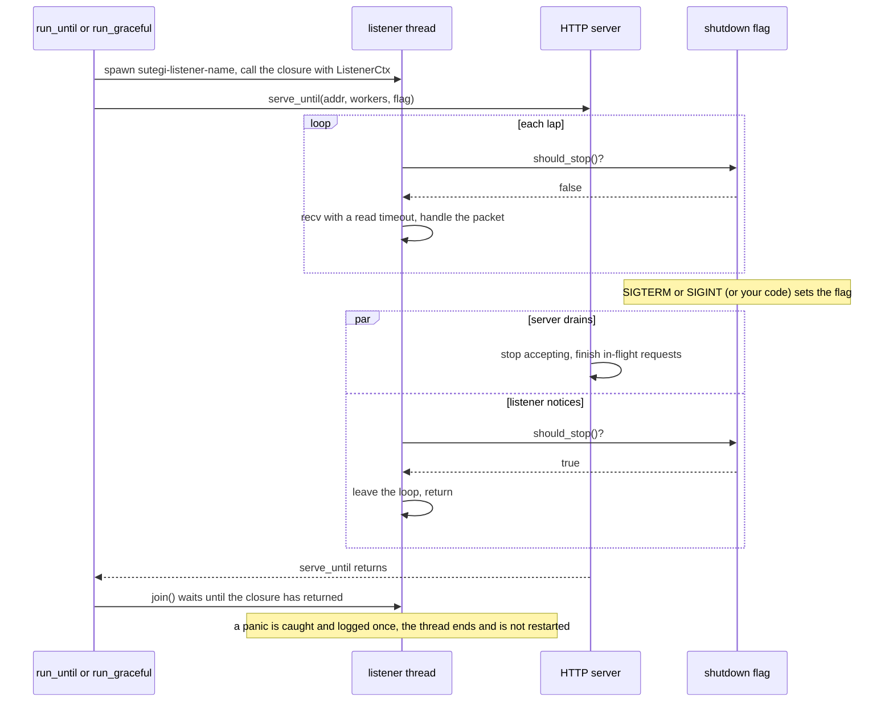

<!-- Generated from landing/src/Docs.svelte. Run: cd landing && pnpm docs:export -->

[← Hexagonal architecture](hexagonal.md) · [Documentation index](../README.md) · [Routing →](routing.md)

# Listeners

`App::listener` registers a long-running loop — a UDP ingest port, a raw TCP protocol, a discovery beacon — that runs on its own thread for the life of the server and shuts down with it. It is a **lifecycle seam, not a protocol**: sutegi does not frame your packets. `std::net` already gives you `UdpSocket` and `TcpListener`; what a hand-spawned thread cannot do is see shared state, drain gracefully, or show up where an agent can discover it. This closes those three gaps and nothing more.

```rust
use sutegi::prelude::*;
use std::net::UdpSocket;
use std::time::Duration;

App::new("metrics-demo")
    .state(db)
    .listener("statsd", "Ingests statsd counters on udp/8125.", |ctx| {
        let sock = UdpSocket::bind("0.0.0.0:8125").unwrap();
        // Bounded read + a should_stop() check each lap IS the shutdown
        // contract: serve() joins listener threads before returning.
        sock.set_read_timeout(Some(Duration::from_millis(250))).unwrap();
        let mut buf = [0u8; 1500];
        while !ctx.should_stop() {
            if let Ok((n, _from)) = sock.recv_from(&mut buf) {
                ingest(ctx.db::<Db>(), &buf[..n]);   // the same state handlers see
            }
        }
    })
    .serve()

// The closure runs once, on a thread named sutegi-listener-statsd, started by
// run / run_until / run_graceful / serve. App::service() never spawns them, so
// the in-process request closure stays socket-free for tests and benches.
// GET /__introspect gains: "listeners": [ { "name": …, "doc": … } ]
```



*Listeners and the HTTP server share one shutdown flag; the server drains, then joins each listener once its closure returns.*

`ListenerCtx` is deliberately tiny: `should_stop()` (true once shutdown has begun), `state::<T>()` / `try_state::<T>()` — the same typed state handlers and tools see — `db::<B>()` as sugar for a backend, and `name()`.

> [!WARNING]
> **The shutdown contract is cooperative**
>
> On shutdown the server stops accepting, drains in-flight HTTP requests, then **joins every listener thread before returning**. That join waits for your loop to notice, so never park in an unbounded blocking read: set a read timeout on the socket and poll `should_stop()` each lap. A listener that never polls holds the process until the orchestrator’s grace period expires and SIGKILL lands — honest, but avoidable.

A panicking listener **does not restart and does not take the server down**: the panic is caught, one line lands on stderr, and the thread ends. If the loop must survive crashes, own that policy — wrap the body in a retry loop, or run it under an [actor supervisor](actors.md) and keep the listener as the thin socket shim. Discovery is name and doc only; which port and protocol the loop speaks belongs in the doc string, where agents read it.

> [!TIP]
> **Deep dive:** [the long-form guide](../LISTENERS.md), with every option and edge case.

---

[← Hexagonal architecture](hexagonal.md) · [Documentation index](../README.md) · [Routing →](routing.md)
