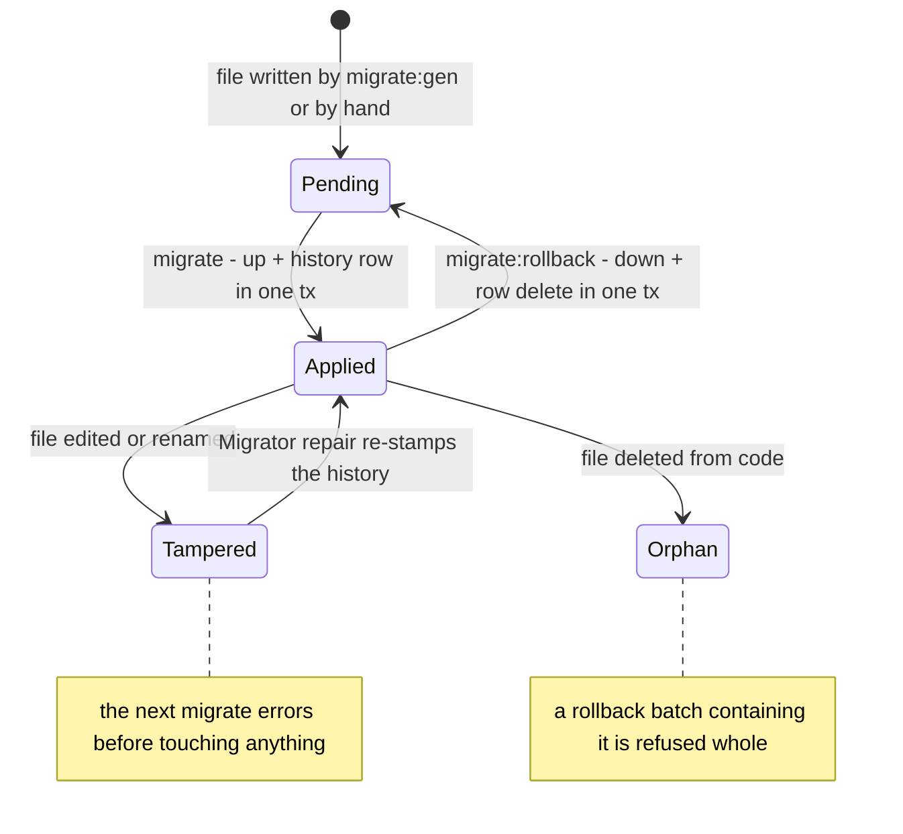
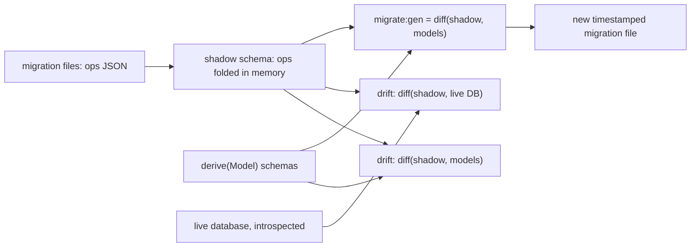
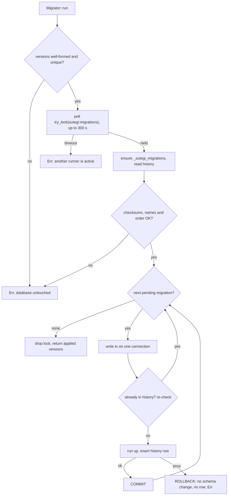

<!-- Generated from landing/src/Docs.svelte. Run: cd landing && pnpm docs:export -->

[← The query builder](queries.md) · [Documentation index](../README.md) · [Locks, isolation, bulk →](concurrency.md)

# Migrations

sutegi turns a change to a `#[derive(Model)]` struct into a versioned, reversible, backend-portable migration — the TypeORM *generate* workflow without the live-database nondeterminism. There are two kinds: **declarative** migrations, a list of schema ops stored as JSON, generated by diffing and reversible for free; and **closure** migrations, hand-written `up`/`down` closures for data backfills and DDL the diff engine does not model.

```rust
use sutegi::prelude::*;

fn migrations() -> Migrator {
    Migrator::new().load_dir(sutegi::migrate::MIGRATIONS_DIR).expect("load migrations")
}

fn main() -> std::io::Result<()> {
    let db = Db::open_or_memory("DATABASE_PATH");
    let models = sutegi::schemas![Todo, User];        // the desired state
    // migrate | :rollback | :status | :gen | :plan | :drift | :fresh
    if sutegi::migrate::dispatch_full(&migrations(), &db, &models,
                                      sutegi::migrate::MIGRATIONS_DIR) {
        return Ok(());                                // a subcommand ran; exit
    }
    migrations().run(&db).expect("migrate");          // else apply pending, then serve
    App::new("todo").state(db).serve()
}
```

```bash
myapp migrate:gen create_todos   # diff models <-> shadow schema; write the file
myapp migrate:plan               # …show what :gen would write, without writing
myapp migrate                    # apply all pending migrations
myapp migrate:status             # the ledger: check applied, ? orphan
myapp migrate:rollback 1         # roll back the last n batches (default 1)
myapp migrate:drift              # three-way report: DB vs migrations vs models
myapp migrate:fresh              # roll everything back and re-run (dev only)
```



*A migration's life as \_sutegi\_migrations sees it, including the edited-file and deleted-file states the guards catch.*

## Diff against history, not the live database

`migrate:gen` computes changes by diffing your models against the *shadow schema* — the schema you get by folding every existing migration’s ops in memory. It never consults your live database to decide what to generate, so the same repository state always produces the same migration no matter what anyone’s local database happens to contain. The live database is consulted for exactly one thing: **drift detection**, which reports both *DB vs migrations* (a hand-edit, or migrations not fully applied) and *models vs migrations* (you changed a model and have not run `:gen`). `sutegi::migrate::report_json` is the same report as JSON, ready to mount at `/__migrations` for agents and dashboards.



*migrate:gen diffs models against the folded history; the live database is read only for the two drift comparisons.*

## Safety classes

- **Safe** — create a table, add a nullable or defaulted column, create an index, add a foreign key, widen a column.
- **NeedsData** — add a `NOT NULL` column with no default, or tighten a column to `NOT NULL`. Valid only against an empty table; give it a `default` or write a backfill.
- **Destructive** — drop a table or column, a lossy type change. `:gen` writes these but flags them loudly; the committed, reviewed file is your approval.

**Renames are never guessed.** A dropped column plus an added column of the same type generate a drop + add pair with a “possible rename?” warning — edit the file to a rename op if that is what you meant, which preserves the data. Applied migrations are checksummed in `_sutegi_migrations`, so editing a file after the fact fails the next `migrate` rather than silently diverging (`Migrator::repair` re-stamps after a deliberate edit). On Postgres, `run`/`rollback` take a session advisory lock, so many pods booting at once serialize instead of racing.



*Migrator::run validates before touching anything, serializes runners on a lock, and applies each migration atomically with its history row.*

> [!TIP]
> **Dev-mode sync**
>
> `Model::migrate` (and `sutegi::orm::migrate::sync`) apply *additive, non-destructive* changes directly — create missing tables, add columns, indexes and foreign keys — with no migration file. They never drop anything and refuse, pointing you at `migrate:gen`, any change that needs a real migration. Use this locally; use files in production.

> [!WARNING]
> **Honest caveats**
>
> `down` restores schema *shape, not data* — a dropped column comes back empty. The schema IR covers tables, columns, secondary indexes and single-column foreign keys; views, triggers, sequences, CHECK constraints and multi-column FKs are out of scope (use a closure migration). On SQLite, changing a column’s type or nullability is a full table rebuild — rows survive, but it is heavier than the in-place `ALTER` Postgres does.

> [!TIP]
> **Deep dive:** [the long-form guide](../MIGRATIONS.md), with every option and edge case.

---

[← The query builder](queries.md) · [Documentation index](../README.md) · [Locks, isolation, bulk →](concurrency.md)
