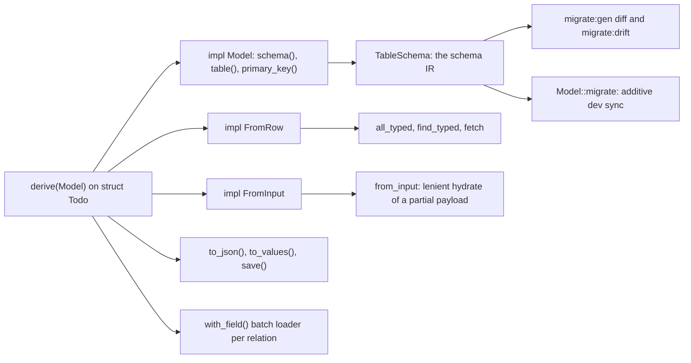

<!-- Generated from landing/src/Docs.svelte. Run: cd landing && pnpm docs:export -->

[← The key/value store](kv.md) · [Documentation index](../README.md) · [Relations →](relations.md)

# Models

Deriving `Model` on a plain struct makes it the single source of truth for a table: schema, migrations, typed reads, JSON serialization, and `save()` all come from it. Bools round-trip as real bools and `Option<T>` becomes a nullable column.

```rust
#[derive(Model, Validate)]
#[model(table = "todos")]          // omit to infer snake_case + plural
struct Todo {
    #[model(primary)]
    id: i64,                        // the DB assigns this on insert
    #[model(unique)]
    slug: String,                   // a UNIQUE constraint in the schema
    #[model(index)]
    owner_id: i64,                  // a secondary index
    title: String,
    #[model(default = false)]
    done: bool,                     // DEFAULT false, so an ADD COLUMN is safe
    note: Option<String>,           // Option<T> -> a nullable column
    #[model(column = "created_ms")]
    created: i64,                   // a column name that differs from the field
    #[model(vector(dim = 384))]
    embedding: Vec<f32>,            // vector(384) on PG, TEXT on SQLite
    #[model(skip)]
    cached: bool,                   // not persisted; default-initialised
}

let db = Db::open_or_memory("DATABASE_PATH");   // pooled, Send + Sync + Clone
Todo::migrate(&db).unwrap();                     // dev-mode additive sync

let all: Vec<Todo> = Todo::all_typed(&db)?;               // typed reads
let one: Option<Todo> = Todo::find_typed(&db, 1.into())?;
let count = Todo::count(&db)?;
let id = todo.save(&db)?;                                  // insert; returns the new pk
Todo::update(&db, 1.into(), &[("done", true.into())])?;   // by primary key
Todo::delete(&db, 1.into())?;

// In a handler, route-model binding parses the param, loads the row, or 404s:
.get("/todos/:id", "show", |c| c.model::<Todo, Db>("id").map(|t| t.to_json()))
```



*One derive on a plain struct generates the schema IR, the typed readers and writers, and a batch loader per relation.*

The `#[model(…)]` attributes are the mapping controls, and everything except `skip` flows into the schema IR the migration diff reads:

- `table = "…"` (struct level) — override the inferred snake\_case plural name.
- `primary` — the primary key. `column = "…"` — a differing column name.
- `unique` / `index` — a UNIQUE constraint / a secondary index.
- `default = <lit>` — a column default (int, float, bool or string), which is what makes adding a `NOT NULL` column a safe migration.
- `vector` / `vector(dim = N)` — an embedding column on a `Vec<f32>`.
- `has_many` / `has_one` / `belongs_to` — a [relation](relations.md), not a column.
- `skip` — not persisted, not serialized, default-initialised on load.

The derive also generates `from_input()` — a lenient hydrate from a partial client payload, which is what tool closures use on already-validated args — and `to_json()`. Both macros run at build time, so syn/quote never reach your binary; turn them off with `default-features = false` and hand-write the `Model` impl if you prefer.

---

[← The key/value store](kv.md) · [Documentation index](../README.md) · [Relations →](relations.md)
