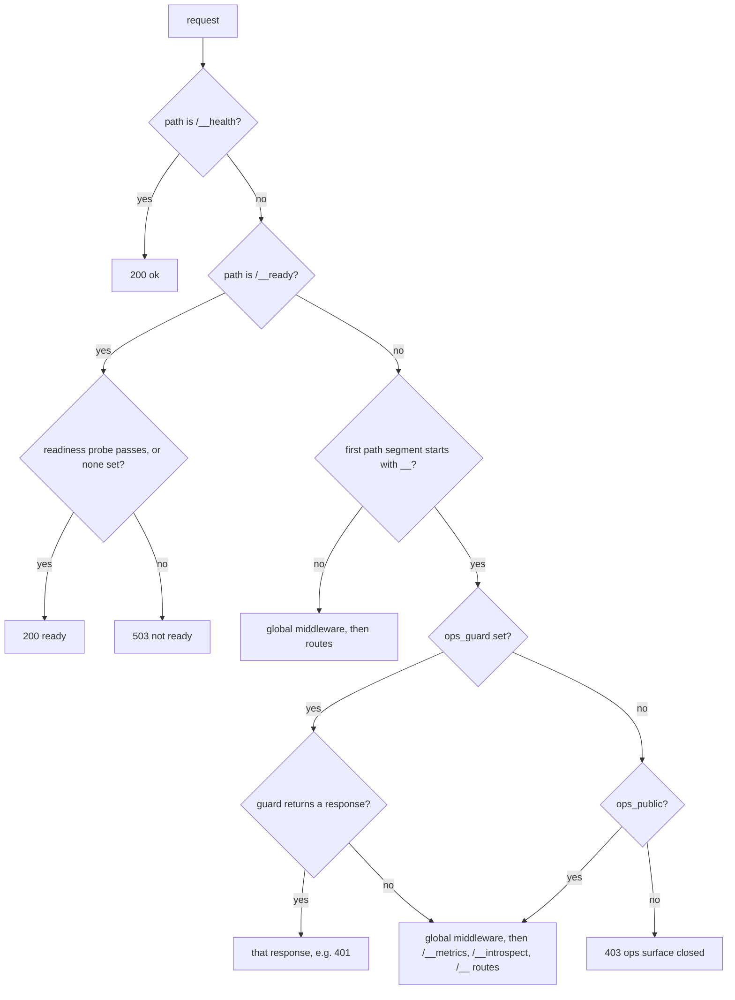

<!-- Generated from landing/src/Docs.svelte. Run: cd landing && pnpm docs:export -->

[← Tuning & limits](options.md) · [Documentation index](../README.md)

# Operational endpoints

Four endpoints are always on, no feature required. `/__health` is liveness (200 while the process is up), `/__ready` runs the probe you register with `.readiness(…)` and returns 200 or 503, `/__metrics` exposes Prometheus text (requests total, in-flight, by status class), and `/__introspect` is the full surface — routes, models, tools, capabilities, searchable tables and [listeners](listeners.md). Features add more endpoints — `/__tools`, `/__channels`, `/__actors` — and you can mount your own, like a read-only `/__migrations`.

```rust
let ready = db.clone();   // the probe keeps its own pooled handle
App::new("api")
    .state(db)
    .readiness(move || ready.query("SELECT 1", &[]).is_ok())
    .register_capabilities(caps)
    .actors(sup.registry())                   // GET /__actors  (feature "actors")
    .get("/__migrations", "Migration status + drift.",
         move |_| json(200, &report))          // your own /__-mounted route
    .ops_guard(|req| gate(req))                // gates every /__ EXCEPT the probes
    .serve()?;                                 // HOST/PORT/WORKERS; SIGTERM drain

// Always on, no feature required:
// GET /__health   liveness (200 while up)     GET /__ready       readiness (200/503)
// GET /__metrics  Prometheus text             GET /__introspect  the full app surface
// GET /__tools    the LLM manifest            GET /__channels    the channel manifest
```



*Probes answer before any guard; every other /\_\_ path passes the ops\_guard before global middleware and routing.*

Because `Db` is `Clone`, clone a handle for the readiness probe before you hand ownership to `.state()`. The probes are intentionally credential-free and disclose nothing; everything else under `/__` is closed by default (`403`). Configure an [`ops_guard`](middleware.md) to grant authenticated access.

---

[← Tuning & limits](options.md) · [Documentation index](../README.md)
