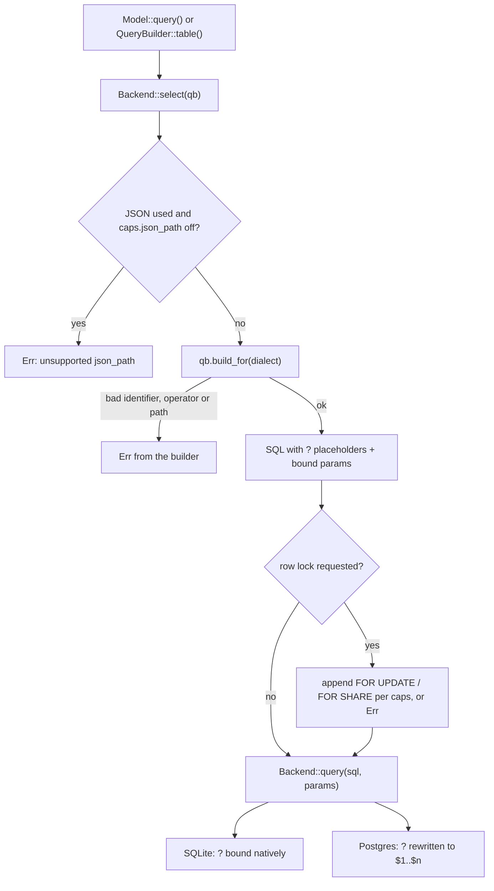

<!-- Generated from landing/src/Docs.svelte. Run: cd landing && pnpm docs:export -->

[← Backends & capabilities](backend.md) · [Documentation index](../README.md) · [Migrations →](migrations.md)

# The query builder

For anything beyond `all`/`find`, `Model::query()` returns a fluent, fully parameterized query builder. Run it through a backend to get JSON rows (`select`), typed values (`fetch`/`fetch_one`), a count, an existence check, or a `Page<T>` (`paginate_typed`). Values are always bound as parameters, and identifiers are validated against an allowlist — an AI tool argument cannot smuggle SQL into a column or sort slot.

```rust
// The parameterized query builder — never string-concatenated, and identifiers
// are guarded against injection (important when an AI tool arg reaches a column).
let overdue = Todo::query()
    .filter("done", "=", false.into())
    .filter("due", "<", now.into())
    .filter_in("owner_id", vec![1.into(), 2.into()])
    .or_group(&[("priority", "=", "high".into()),
                ("pinned",   "=", true.into())])
    .where_not_null("assignee")
    .like("title", "%urgent%")
    .join("users", "users.id", "todos.owner_id")     // JOIN / LEFT JOIN
    .group_by(&["users.name"]).distinct()
    .where_raw("created_at > ?", vec![0.into()])      // the explicit escape hatch
    .order_by("due", false)          // false = ASCENDING; true = DESC
    .limit(20)
    .offset(0);

let rows: Vec<Todo> = db.fetch(&overdue)?;                   // typed
let one: Option<Todo> = db.fetch_one(&overdue)?;
let page: Page<Todo> = db.paginate_typed(&overdue, 1, 20)?;  // .items / .total / .has_next()
let n = db.count(&overdue)?;
let any = db.exists(&overdue)?;

// Writes have builders too — and RETURNING, so no re-SELECT race:
UpdateBuilder::table("todos").set("done", true.into())
    .filter("id", "=", 5.into()).returning(&["id", "title"]);
DeleteBuilder::table("todos").filter("id", "=", 5.into());

// Raw SQL is always available:
let rows = db.query("SELECT count(*) AS n FROM todos WHERE done = ?", &[true.into()])?;
```

> [!WARNING]
> **`order_by`’s bool is *descending***
>
> `.order_by("due", false)` is **ascending**; `true` is descending. Chain several for multi-column ordering.

`QueryBuilder`, `UpdateBuilder` and `DeleteBuilder` can also be used directly against a table name when there is no model, and `build()` hands you the `(sql, params)` pair — which is why the core ships no driver at all and the default binary stays tiny.



*The builder only stores the request; Backend::select gates on capabilities, compiles for its dialect, adds row locks, then binds the parameters.*

---

[← Backends & capabilities](backend.md) · [Documentation index](../README.md) · [Migrations →](migrations.md)
