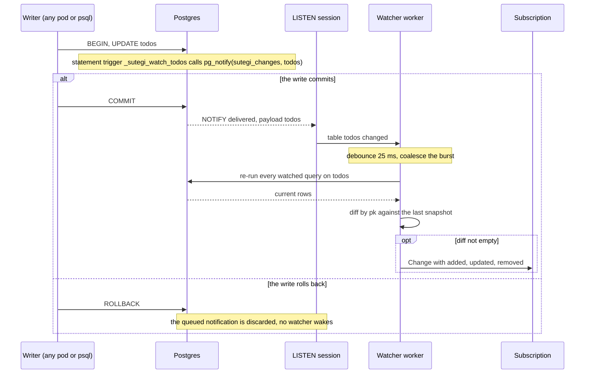

<!-- Generated from landing/src/Docs.svelte. Run: cd landing && pnpm docs:export -->

[← Embeddings & vectors](vectors.md) · [Documentation index](../README.md) · [The key/value store →](kv.md)

# Reactive queries

`watch(query)` gives you the current rows plus **pushed diffs** whenever the watched result actually moves. It is the primitive that unifies LISTEN/NOTIFY, the event-store wakeups and cross-pod pubsub into one shape — and it turns a channel topic into a live query in one loop.

```rust
use sutegi::orm::watch::Watcher;

let watcher = Watcher::postgres(&pg)?;      // one per process (Watcher::sqlite(&db))
let sub = watcher.watch(
    Todo::query().filter("done", "=", false.into()),
    "id",                                    // the pk the diff keys on
)?;

for row in sub.rows() { /* the result at watch time */ }
while let Some(change) = sub.recv_timeout(Duration::from_secs(30)) {
    // Change { table, added, updated, removed } — only when the watched
    // result actually moved. to_json() is broadcast-ready:
    hub.broadcast("todos:lobby", "changed", &change.to_json());
}

// Postgres: watch() idempotently installs a statement-level _sutegi_watch_<t>
// trigger that pg_notify's a shared channel, received on a dedicated LISTEN
// session — so ANY pod's committed write (psql included) wakes every pod's
// watchers, and a rolled-back write never fires. SQLite: update_hook on every
// pooled connection, this process only.
```

The semantics are table-coarse requery-diff (v1): on a change to a watched table — debounced 25 ms, bursts coalesced — each watcher re-runs its query and diffs by primary key. A new pk is `added`, a vanished pk is `removed`, a same-pk-different-row is `updated`, and a write that does not move the watched result emits **nothing** (the requery runs, the diff is empty, nothing is sent). Twenty writes in one window typically become one `Change` carrying twenty rows.



*On Postgres a committed write wakes every watcher through NOTIFY, then a requery and a pk diff; a rolled-back write wakes no one.*

Guardrails: 1024 live subscriptions per watcher, dropping a subscription unregisters it, and dropping the watcher shuts the worker down — interrupting the blocked LISTEN session on Postgres. One watcher per process per backend handle. On SQLite, attach the watcher before serving traffic, and remember that writes from other processes on the same file are invisible.

> [!TIP]
> **Deep dive:** [the long-form guide](../REACTIVE.md), with every option and edge case.

---

[← Embeddings & vectors](vectors.md) · [Documentation index](../README.md) · [The key/value store →](kv.md)
