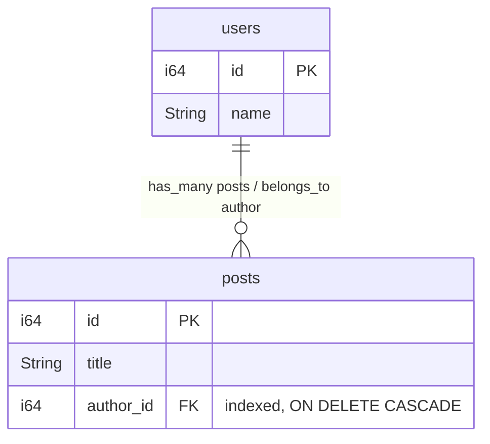
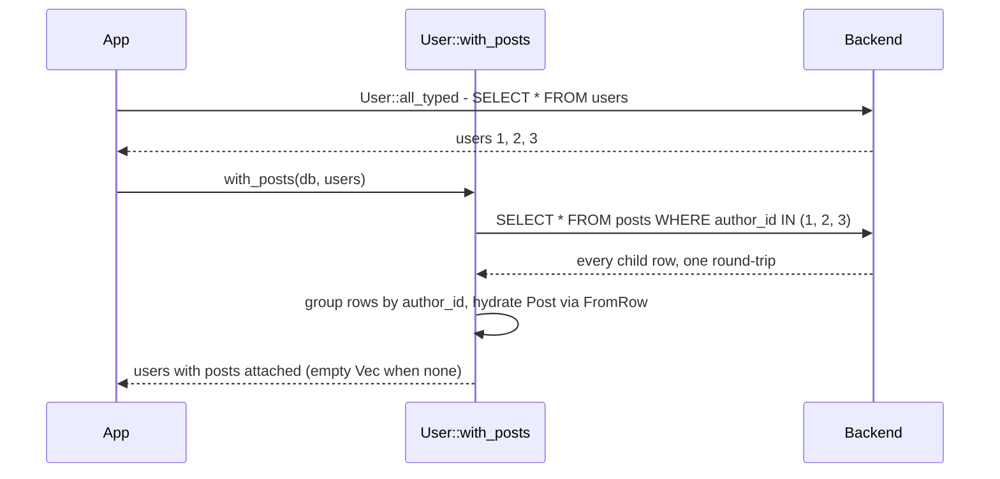

<!-- Generated from landing/src/Docs.svelte. Run: cd landing && pnpm docs:export -->

[← Models](models.md) · [Documentation index](../README.md) · [The agent surface →](agents.md)

# Relations

A relation field is declared with an attribute, is not a column, and gets its own generated batch loader. `User::with_posts(&db, users)` runs one `WHERE author_id IN (…)` query for the whole batch and attaches the typed children — the classic two-query strategy, so N+1 never arises.

```rust
#[derive(Model)]
struct User {
    #[model(primary)] id: i64,
    name: String,
    #[model(has_many(Post, foreign_key = "author_id"))]
    posts: Vec<Post>,               // not a column
}

#[derive(Model)]
struct Post {
    #[model(primary)] id: i64,
    title: String,
    #[model(index)] author_id: i64,
    #[model(belongs_to(User, foreign_key = "author_id", on_delete = "cascade"))]
    author: Option<User>,           // the FK flows into the schema IR
}

// The derive generates one batch loader per relation: two queries, never N+1.
let users = User::all_typed(&db)?;
let users = User::with_posts(&db, users)?;      // WHERE author_id IN (…)
for u in &users { println!("{} wrote {}", u.name, u.posts.len()); }

let posts = Post::with_author(&db, Post::all_typed(&db)?)?;
```



*The running example: posts.author\_id is the indexed foreign key both relation fields join on.*

`belongs_to` also carries the foreign key into the schema, including `on_delete = "cascade"`, so the migration diff sees it. Join keys are integers (the usual primary/foreign-key case), and loading is explicit rather than lazy: there is no hidden query behind a field access.



*with\_posts loads every child in one IN (…) query and groups the rows in Rust: two queries, not N+1.*

---

[← Models](models.md) · [Documentation index](../README.md) · [The agent surface →](agents.md)
