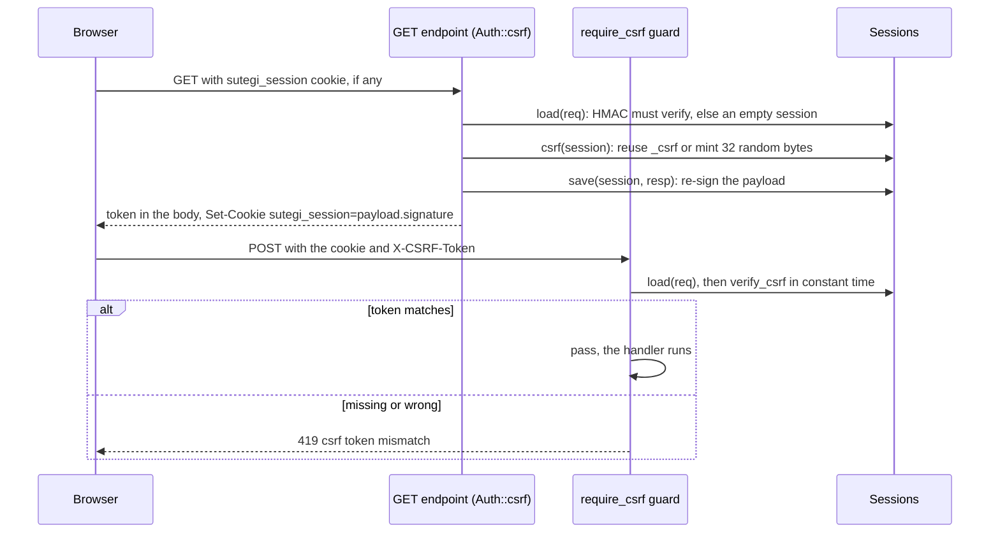

<!-- Generated from landing/src/Docs.svelte. Run: cd landing && pnpm docs:export -->

[← Templates](templates.md) · [Documentation index](../README.md) · [Validation →](validation.md)

# Sessions & CSRF

The `session` feature provides signed-cookie sessions (HMAC-SHA256) with no server-side store: `Sessions::new(secret)`, then `load` a session off the request, `set`/ `get`/`remove` values, and `save` it onto the response. A bare session expires only through the cookie’s `Max-Age` (24 hours by default, `.max_age(…)`), which the client controls: a stolen cookie stays valid. For logins, use [Auth](auth.md), which stamps an `exp` inside the signed payload (`Auth::ttl`) so a stolen session dies on schedule no matter what the client claims. Call `.insecure()` in local `http://` development to drop the cookie’s `Secure` flag.

```rust
// Signed-cookie sessions (HMAC-SHA256). No server-side store needed.
let sessions = Sessions::new(secret.as_bytes());

.post("/cart/add", "Add to cart", move |c| {
    let mut s = sessions.load(c.req);
    s.set("last_item", Json::str("sku-42"));
    Ok::<_, Error>(sessions.save(&s, json(200, &Json::obj(vec![("ok", Json::Bool(true))]))))
})

// CSRF lives inside the signed session — get-or-mint, then verify in constant time.
let mut s = sessions.load(c.req);
let token = sessions.csrf(&mut s)?;              // 32 random bytes, stable per session
let ok = sessions.verify_csrf(&s, presented);
// Auth::csrf(req, resp) is the handler shape; the require_csrf guard enforces
// X-CSRF-Token on mutating methods (419 on mismatch). It passes reads, and a
// Bearer stg_… API token sent with no session cookie — no ambient credential.
// Basic auth, other bearers, or any session cookie keep the check on.

// For callers that collect cookies before touching a response:
let set_cookie = sessions.cookie_for(&s);
```



*The CSRF token lives inside the signed cookie, so issuing and checking it needs no server-side store.*

This is the machinery [`Auth`](auth.md) is built on; use it directly for lightweight per-visitor state like a cart or a wizard step.

---

[← Templates](templates.md) · [Documentation index](../README.md) · [Validation →](validation.md)
