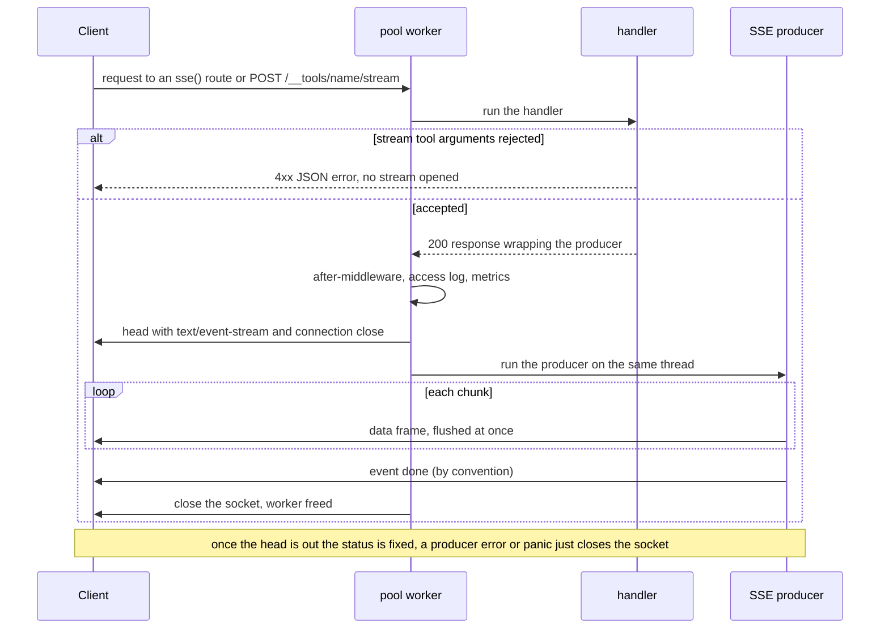

<!-- Generated from landing/src/Docs.svelte. Run: cd landing && pnpm docs:export -->

[← Defining tools](tools.md) · [Documentation index](../README.md) · [WebSockets →](websockets.md)

# Streaming & SSE

Because the server is blocking and thread-per-connection, streaming is trivial and naturally backpressured — there is no executor to fight. `sse(producer)` gives the producer an `SseSink` with `data`, `event`, and `comment`; each frame is flushed immediately. `stream(status, content_type, producer)` is the raw-bytes equivalent for NDJSON and large exports.

```rust
.get("/stream", "SSE demo", |_| sse(|sink| {
    for token in answer().split(' ') {
        sink.data(token)?;          // each frame is flushed immediately
    }
    sink.comment("keep-alive")?;    // a ':'-prefixed no-op frame
    sink.event("done", "{}")        // a named event
}))

// Raw byte streams — NDJSON, large exports — take the same shape:
.get("/export", "Stream rows", |_| stream(200, "application/x-ndjson", |sink| {
    for row in rows() { sink.write_str(&format!("{}\n", row.to_json()))?; }
    Ok(())
}))

// Regular responses use keep-alive; streams are close-framed by design.
```



*A stream fixes its 200 status before the producer runs; frames are then flushed one by one on the same worker until the socket closes.*

It is the same transport that carries live LLM tokens back to a UI and the one `.stream_tool` rides on. Regular responses use keep-alive; streams are close-framed by design, which is valid HTTP/1.1 and needs no chunked encoding. Behind nginx, set `proxy_buffering off` — the `ontzi` config already does.

---

[← Defining tools](tools.md) · [Documentation index](../README.md) · [WebSockets →](websockets.md)
