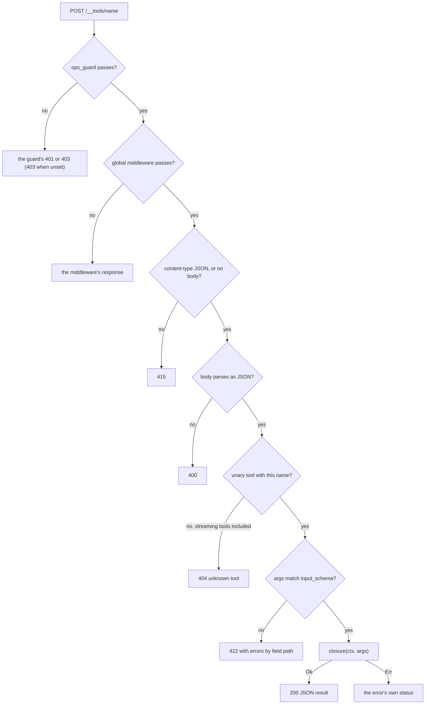

<!-- Generated from landing/src/Docs.svelte. Run: cd landing && pnpm docs:export -->

[← The agent surface](agents.md) · [Documentation index](../README.md) · [Streaming & SSE →](streaming.md)

# Defining tools

Tools are first-class on the `App`. `.tool(name, description, schema, closure)` registers a unary tool; the closure receives the already schema-validated arguments and an owned context that shares app state (`c.db::<Db>()`, `c.state::<T>()`). Build the argument schema with the `schema::` helpers (`object`, `string`, `integer`, `boolean`, `array`). `.stream_tool(…)` is the same, but the closure also gets an `SseSink` to stream results as Server-Sent Events, and the manifest marks it `"streaming": true` so an agent knows to hit the SSE endpoint.

```rust
App::new("todo")
    .state(db)
    // A unary tool: the closure gets schema-validated args and shared state.
    .tool("create_todo", "Create a todo with the given title.",
        schema::object(vec![("title", schema::string("the todo's title"))], &["title"]),
        |c, args| {
            let todo = Todo::from_input(&args)?;      // args already validated
            let id = todo.save(c.db::<Db>())?;
            Ok(Todo { id, ..todo }.to_json())
        })
    // A streaming tool: write Server-Sent Events to the sink.
    .stream_tool("stream_answer", "Stream an answer token by token.",
        schema::object(vec![("prompt", schema::string("the prompt"))], &["prompt"]),
        |_c, args, sink| {
            let prompt = args.get("prompt").and_then(Json::as_str).unwrap_or("");
            for token in prompt.split(' ') { sink.data(token)?; }
            sink.event("done", "{}")
        })
    .serve()

// POST /__tools/create_todo         -> invoke (422 on a bad shape)
// POST /__tools/stream_answer/stream -> the SSE variant
```



*Each check a unary tool call passes, and the status it returns when it fails (the 422 schema check needs the validate feature).*

A tool and an HTTP route can — and usually should — be two adapters over one [use case](hexagonal.md). Write the logic once; expose it to both audiences.

---

[← The agent surface](agents.md) · [Documentation index](../README.md) · [Streaming & SSE →](streaming.md)
