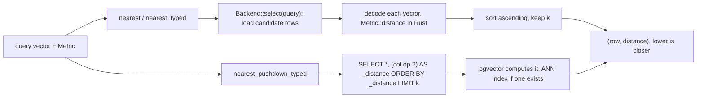

<!-- Generated from landing/src/Docs.svelte. Run: cd landing && pnpm docs:export -->

[← Full-text & hybrid search](search.md) · [Documentation index](../README.md) · [Reactive queries →](reactive.md)

# Embeddings & vectors

Embeddings are a first-class column type, not a blob you decode by hand. A `#[model(vector(dim = N))]` field becomes `vector(N)` on Postgres (pgvector) and `TEXT` on SQLite, and travels in pgvector’s canonical `[1,2,3]` text form so the same value round-trips identically on either backend.

```rust
use sutegi::orm::embedding::{self, Metric};

#[derive(Model)]
struct Doc {
    #[model(primary)] id: i64,
    body: String,
    #[model(vector(dim = 384))] embedding: Vec<f32>,
}

// Portable brute force — correct on every backend, ideal for SQLite:
let hits: Vec<(Doc, f32)> = embedding::nearest_typed::<Doc, _>(
    &db, &Doc::query(), "embedding", &query_vec, 10, Metric::Cosine,
)?;

// Pushdown — pgvector computes the distance and can use an ANN index:
// SELECT *, (embedding <=> ?) AS _distance FROM docs ORDER BY _distance LIMIT k
// Check capabilities().vector first (Postgres + the pgvector extension); the
// call itself does not, and on SQLite fails with an engine error.
let hits = embedding::nearest_pushdown_typed::<Doc, _>(
    &pg, "docs", "embedding", &query_vec, 10, Metric::Cosine,
)?;

// Values travel in pgvector's canonical [1,2,3] text form, so the same row
// round-trips identically on either backend. Lower distance = closer.
```

Two search paths share the same distance semantics (lower is closer, matching pgvector’s operators): portable brute force, which loads candidates and ranks them in Rust, and pushdown, which sends `ORDER BY col <=> ? LIMIT k` to the database and uses its ANN index. `Metric` covers cosine, L2 and inner product. sutegi does not compute embeddings — call whatever model you use and store the vector.



*Brute force ranks candidates in Rust on any backend; pushdown has pgvector compute the distance and can use an ANN index.*

> [!WARNING]
> **Dimension changes are invisible to drift**
>
> A `vector(dim)` column reflects back dimensionless from Postgres introspection (the dimension lives in a catalog the reflection does not read), so changing it is not detected by `migrate:drift`. Declare that change in a migration explicitly.

---

[← Full-text & hybrid search](search.md) · [Documentation index](../README.md) · [Reactive queries →](reactive.md)
