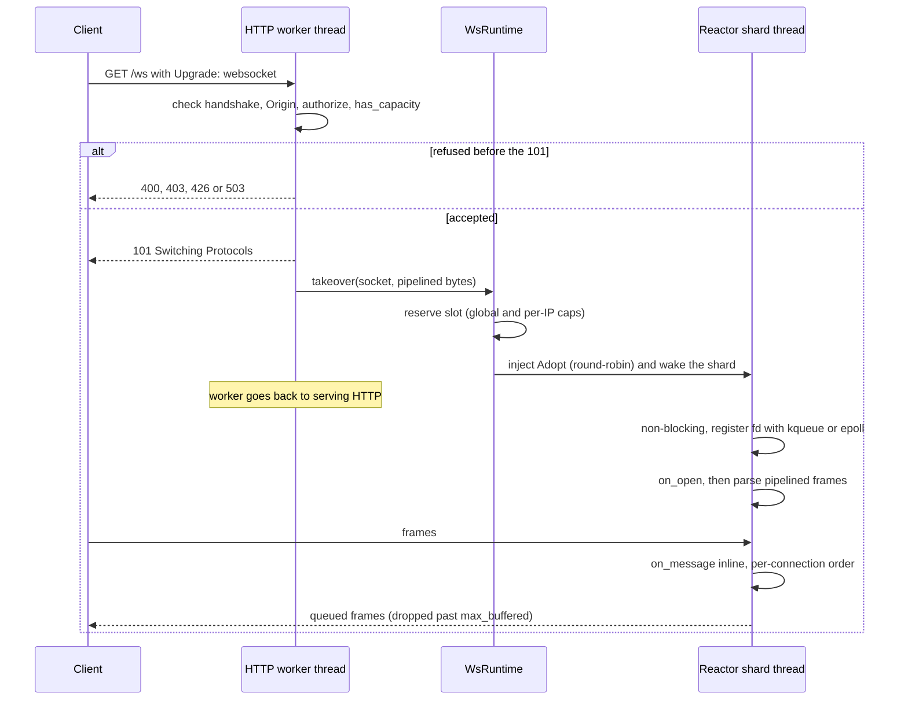

<!-- Generated from landing/src/Docs.svelte. Run: cd landing && pnpm docs:export -->

[← Streaming & SSE](streaming.md) · [Documentation index](../README.md) · [PubSub →](pubsub.md)

# WebSockets

The `ws` feature adds `App::ws`. The HTTP side stays blocking thread-per-connection, but an upgraded socket **detaches** into a sharded kqueue/epoll reactor — no async runtime, no futures, just poller syscalls — so the worker thread is freed immediately and an idle connection costs ~340 bytes of user-space RSS and **zero threads**.

```rust
use sutegi::prelude::*;

App::new("live")
    // Tune the engine BEFORE the first .ws(...) — that call starts the reactor.
    .ws_config(WsConfig { shards: 4, ping_interval: Duration::from_secs(20),
                          ..WsConfig::default() })
    .ws("/socket", "A raw WebSocket endpoint.", Ws::new()
        // A cookie-authenticated socket MUST pin its origins (CSWSH):
        .check_origin(["https://app.example.com"])
        .authorize(|req| req.header("authorization").is_some())
        .on_open(|conn, _req| conn.send_text("welcome"))
        .on_message(|conn, msg| match msg {
            Msg::Text(t) => conn.send_text(&t.to_uppercase()),
            Msg::Binary(b) => conn.send_binary(&b),
        })
        .on_close(|conn, code| println!("{} left ({code})", conn.id())))
    .serve()

// Broadcast: encode the frame ONCE and share the Arc across every queue.
let frame = text_frame("maintenance at noon");
for conn in &conns { conn.send_shared(&frame); }
```



*The HTTP worker checks the handshake, writes the 101 and hands the raw socket to a reactor shard, then goes back to serving HTTP.*

Measured on a dev laptop: 80,000 live sockets at 0.0% idle CPU, a broadcast enqueue of 80k shared-`Arc` frames in ~1.5 ms, and 5k-fleet delivery at p50 15 ms / max 30 ms end-to-end. The codec is strict RFC 6455 — masking required, minimal length encodings, control-frame rules, close-code validation, UTF-8 enforcement — with a deterministic fuzz suite behind it.

- **Callbacks run inline on the shard**, which is what guarantees per-connection ordering. Keep them CPU-quick; push blocking work to your own threads and answer later through the cloneable `Conn`.
- **Broadcast by cloning one encoded frame.** `text_frame`/`binary_frame` encode once into an `Arc`; `send_shared` puts it on each queue.
- **Slow consumers are dropped** at `max_buffered`; ping and idle sweeps close dead sockets; `RLIMIT_NOFILE` is raised at startup.
- Every knob lives in [`WsConfig`](options.md), and `ws_config` must come *before* the first `.ws(…)` — that call starts the reactor.

> [!WARNING]
> **Cookie-authenticated sockets and origins**
>
> A browser sends cookies on a cross-origin WebSocket handshake and the same-origin policy does not stop it, so sutegi does: by default an upgrade whose `Origin` names a different host than `Host` gets a `403`. Call `check_origin([…])` when the page is served from another host or a proxy rewrites `Host`. `allow_any_origin()` turns the check off — only for public sockets that do not authenticate by cookie, or any page on the internet can open one as your user (CSWSH).

> [!TIP]
> **Deep dive:** [the long-form guide](../REALTIME.md), with every option and edge case.

---

[← Streaming & SSE](streaming.md) · [Documentation index](../README.md) · [PubSub →](pubsub.md)
